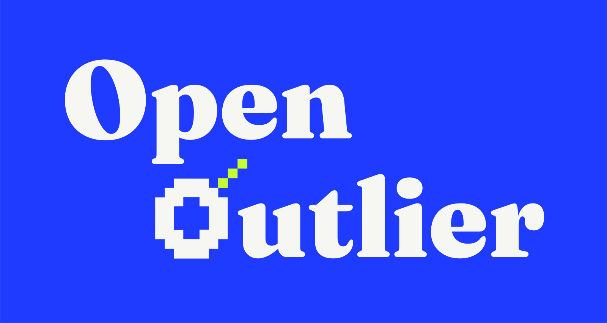
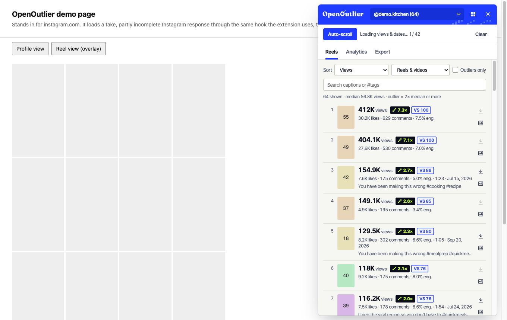
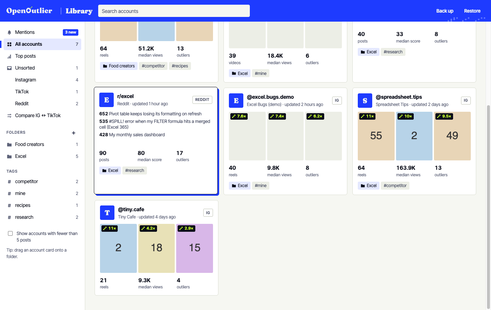
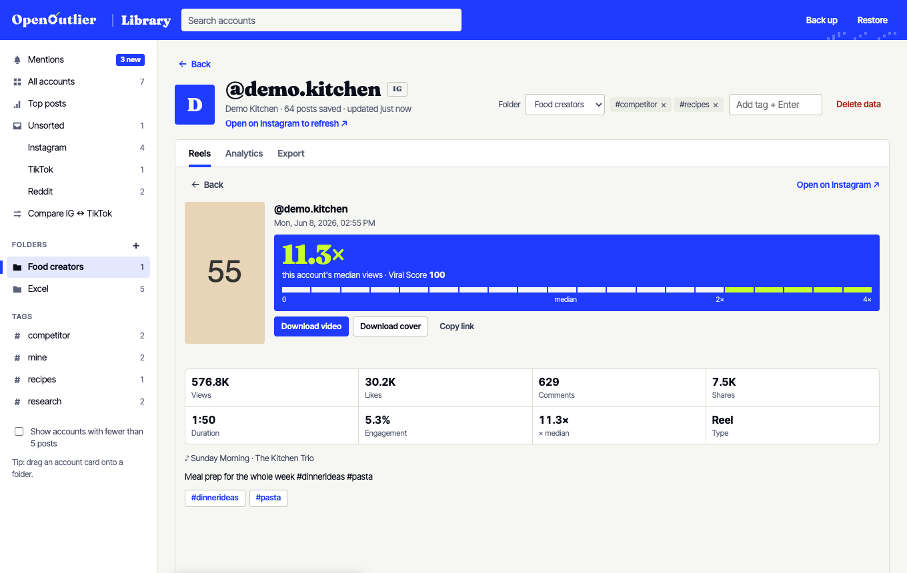
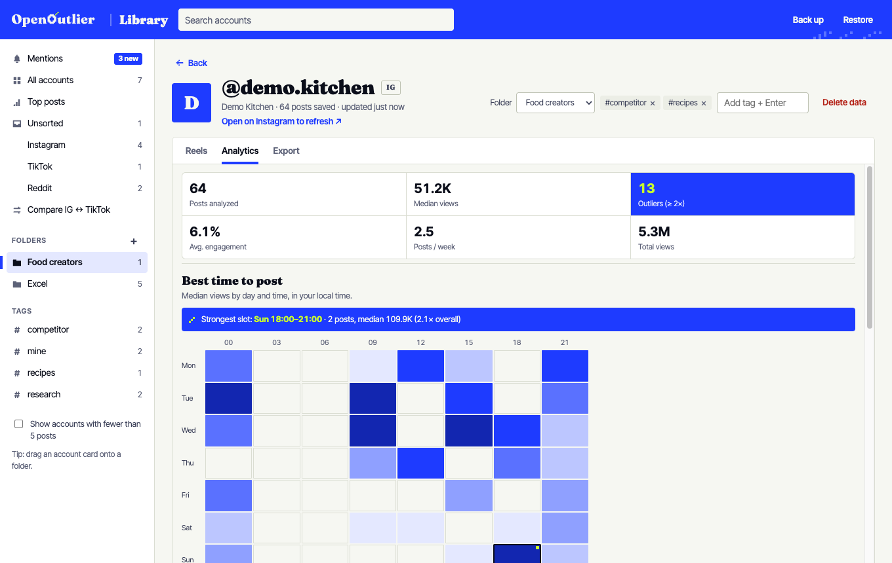
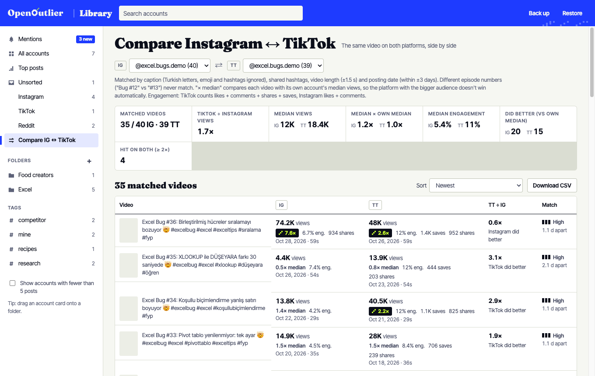
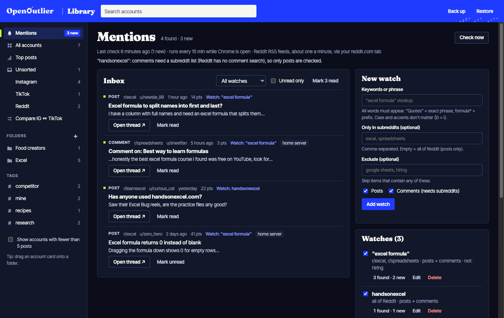
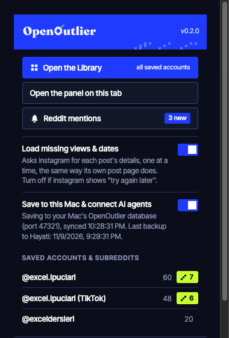

<p align="center">
  
</p>

<p align="center">
  <b>Find the posts that broke away from an account's normal.</b><br>
  Free, open-source analytics for Instagram Reels, TikTok, YouTube and Reddit, right inside the page you're on.
</p>

<p align="center">
  <a href="LICENSE">MIT license</a> · Chrome &amp; Edge (Manifest V3) · no account, no tracking, no server · <a href="#install">Install</a> · <a href="#connect-ai-agents-mcp">MCP for AI agents</a>
</p>

---

Most posts land near an account's median. A few get **2×, 5×, 10× that**. Those outliers tell you which hooks, topics, lengths and posting times work, for you and for the accounts you learn from. OpenOutlier collects the posts your browser already loads on instagram.com, tiktok.com, youtube.com and reddit.com, scores each one against its own account's median (on YouTube: Shorts and long-form videos each against their own), and shows you the ones that broke away.

<p align="center">
  
</p>

## What it does

- **Outliers, in one number.** Every post gets `views ÷ account median`. At 2× or more it gets a lime outlier badge (`9.0×`), and you can filter to outliers only.
- **Viral Score (0–100).** `50 + 25 × log2(views ÷ median)`: 50 is a typical post, 75 is 2×, 100 is 4× or more.
- **Sort what the apps won't sort.** Reels, TikTok videos and YouTube videos and Shorts by views, Viral Score, likes, comments, shares, saves, engagement, date or length. Reddit posts by score, comments, upvote ratio or comments per point.
- **Best time to post.** A day × time heatmap in your local time. Each post is compared with what the account was getting at the time (so growth doesn't make old slots look bad), slots with few posts are pulled toward 1×, and only slots with 8+ posts are ranked. It also scores days and times separately, shows each slot's share of posts, and warns when an account posts at too few times to compare.
- **What works.** Hashtags, video length and sound (original vs. music) ranked by median views. On YouTube: Shorts vs. long-form, title words and phrases, chapters and the "most replayed" moments. On Reddit: questions vs. statements, title length, words and phrases, flair and post type.
- **Compare platforms.** Post the same videos on Instagram, TikTok and YouTube Shorts? OpenOutlier pairs them and shows which platform did better relative to each account's own median.
- **Library.** Every account you collect, in folders and tags, with a cross-account *Top posts* ranking, account pages and a Reddit *Mentions* inbox for keyword alerts.
- **Export & download.** CSV, copy-for-Sheets/Excel or JSON. Videos, photos and covers saved with their stats in the file name (YouTube videos through yt-dlp on your Mac).
- **AI agents.** A local MCP server lets Claude, Cursor or any MCP client query your library, rank posts, pull mp4s and turn Reddit questions into content ideas.

Everything runs and stays in your browser (plus an optional SQLite copy on your own Mac). OpenOutlier only reads; it never posts, likes, follows, votes, comments or sends messages.

> OpenOutlier is an independent project. It is not affiliated with Instagram, Meta, TikTok, ByteDance, YouTube, Google, Reddit, or any commercial analytics tool.

## A look around

| | |
|---|---|
|  |  |
| **Library.** All accounts with median, outliers and their best posts; folders, tags, platform filters. | **Post detail.** The verdict (× median and Viral Score), every stat, caption, hashtags, downloads. |
|  |  |
| **Analytics.** Outliers, engagement, posts per week and the best-time heatmap. | **Compare IG ↔ TikTok.** The same video on both platforms, each against its own median. |
|  |  |
| **Mentions.** Keyword watches on Reddit with an inbox, in light or dark. | **Toolbar popup.** Library, panel, settings and your saved accounts with their outlier counts. |

## Install

OpenOutlier isn't in the Chrome Web Store yet. Load it in developer mode:

1. Download this repository (`git clone`, or **Code → Download ZIP** and unzip).
2. Open `chrome://extensions` (Edge: `edge://extensions`) and turn on **Developer mode**.
3. Click **Load unpacked** and pick the folder that contains `manifest.json`.
4. Reload any open Instagram, TikTok, YouTube and Reddit tabs.
5. Optional, for YouTube video files: `brew install yt-dlp ffmpeg deno` and the bridge (see [YouTube video downloads](#youtube-video-downloads-yt-dlp)). Everything else works without them.

## Use

**Instagram.** Open a profile's Reels tab (`instagram.com/<name>/reels/`), then scroll or press **Auto-scroll** in the OpenOutlier panel (the blue button at the bottom right). Use the **Reels**, **Analytics** and **Export** tabs. On a reel page (`/reel/…`, `/p/…`) a small toolbar sits on the video: download, cover, and a stats card with the post's × median.

**TikTok.** Open a profile (`tiktok.com/@name`), scroll or press **Auto-scroll** until the panel says it has all videos, then use **Videos**, **Analytics** and **Export**. TikTok shows shares and saves publicly, so engagement counts likes + comments + shares + saves, and Analytics adds shares and saves per 100 views. Saved as `tt/name` in the Library.

**YouTube.** Open a channel's **Videos** or **Shorts** tab (`youtube.com/@name/videos`, `/@name/shorts`), scroll or press **Auto-scroll**, then use the **Videos / Shorts** switch, **Analytics** and **Export**. Shorts and long-form videos each get their own median, so Shorts don't make every video look like an outlier. Channel tabs show rounded views ("63K") and relative dates ("3 weeks ago", none at all on the Shorts tab): those are marked `≈`. Open a video (or press **Get exact stats** for the top outliers) to replace them with exact views, likes, comments and the publish date. On a video or Short a toolbar shows its × median, Viral Score and the "most replayed" moments. Saved as `yt/name` in the Library.

**Reddit.** Open a subreddit or a user while logged in (`reddit.com/r/excel/`), press **Collect top posts** (it opens the top posts of the year and scrolls them) or scroll yourself, then use **Posts**, **Analytics** and **Export**. Saved as `r/excel` / `u/name`.

**Library.** Toolbar popup → **Open the Library**, or the grid button in the panel. Drag account cards onto folders, add tags on an account page, filter by platform (IG, TT, YT, Reddit), rank **Top posts** across a folder (every platform together, each post against its own account's median), and open **Compare IG ↔ TikTok** when you have both.

Data is saved per account in `chrome.storage.local`. Delete it with **Clear** in the panel or **Delete all data** in the popup.

## Features in detail

<details>
<summary><b>Instagram</b></summary>

| | |
|---|---|
| **Sort reels** | by views, Viral Score, likes, comments, shares, engagement rate, date or length. Instagram itself can't sort a profile by views. |
| **Outliers** | posts with ≥ 2× the profile's median views get a `2.4×` badge; filter to outliers only. |
| **Best time to post** | day × time heatmap of era-adjusted lift (views ÷ the account's median at the time), in your local time; thin slots are faded and pulled toward 1×, best day and best time are scored separately, and a note says when there isn't enough variety to compare. |
| **Hashtags** | ranked by the median views of the posts that use them. |
| **Video length & audio** | median views by duration bucket; original audio vs. licensed music; top tracks. |
| **Export** | CSV download, copy as a table for Google Sheets / Excel, or JSON. |
| **Reel overlay** | on any reel or post page: download, cover download and a stats card (views, likes, comments, shares, duration, engagement, × the creator's median). |
| **Download** | videos, photos, carousel slides or covers, one at a time or the whole list, to `Downloads/OpenOutlier/<username>/` with the stats in the name: `1.2Mviews_11.1Klikes_13Kcomments_2.0pct_post_CODE.mp4`. |
| **Post detail** | click any post for the detail card; ⌘/Ctrl-click opens it on Instagram. |
| **Dark mode** | follows the site's theme. |

Instagram's profile grids send slim records (the Reels tab often leaves out the date, caption and length). To fill the gaps OpenOutlier asks Instagram for one post's details at a time (`/api/v1/media/{id}/info/`, the same request Instagram's own post page makes), about 2 seconds apart, backing off for 30, 60, then 120 s if Instagram says to slow down. Turn it off in the popup (**Load missing views & dates**) to only read what Instagram loads while you scroll.

Instagram has renamed its view counter several times. `src/extract.js` checks `play_count`, `ig_play_count`, `view_count`, `video_view_count`, `video_play_count` and `fb_play_count`, in that order; if counts stop showing up after an Instagram update, start there.
</details>

<details>
<summary><b>TikTok</b></summary>

| | |
|---|---|
| **Sort videos** | by views, Viral Score, likes, comments, **shares**, **saves**, engagement rate, date or length; no 20–25 video limit. |
| **Analytics** | outliers and Viral Score against the account's median, best-time heatmap, hashtags (TikTok's own hashtag list), video length, original sound vs. music, top music, shares and saves per 100 views. |
| **Export** | CSV / Sheets / JSON with TikTok columns (`platform, …, shares, saves, …, sound, hashtags, caption`). |
| **Video overlay** | on `/@name/video/<id>`: views, likes, comments, shares, saves, length, engagement, × the creator's median, sound; download video and cover. |
| **Downloads** | `Downloads/OpenOutlier/tt_<name>/250Kviews_12Klikes_300comments_1.1Kshares_2.4Ksaves_6.3pct_tiktok_<id>.mp4`. |

**Where the data comes from: only what tiktok.com already loads in your tab.** TikTok signs its API requests (X-Bogus, X-Gnarly, msToken), so OpenOutlier makes none of its own:

1. `src/hook.js` reads the responses of TikTok's own `/api/post/item_list/`, `/api/item/detail/`, `/api/repost/item_list/`, `/api/recommend/item_list/` and `/api/search/…` calls as they arrive.
2. It reads the JSON TikTok embeds in the page (`__UNIVERSAL_DATA_FOR_REHYDRATION__`, older `SIGI_STATE`) for the video page and the profile's follower and video counts.
3. **Auto-scroll** scrolls the profile so TikTok loads the next page by itself. If TikTok shows a puzzle, OpenOutlier stops and asks you to solve it.

**Video downloads.** TikTok's video links only work with the site's session and referer. OpenOutlier first tries a normal download; if TikTok refuses, it fetches the file inside an open tiktok.com tab and saves those bytes. From the Library, keep a tiktok.com tab open for video downloads. Links expire after hours to days; open the profile again to refresh them.

**Compare platforms** (Instagram ↔ TikTok, or a YouTube channel's Shorts ↔ Instagram or TikTok). A pair needs a similar caption (Turkish letters, emoji and hashtags ignored), shared hashtags, the same length (±1.5 s) and dates within ±3 days; different episode numbers ("Bug #12" vs "#13") never match. You see views, engagement and × each account's own median, which side did better, the typical TikTok ÷ Instagram ratio, hits on both, and videos posted on only one side. Download the pairs as CSV. On YouTube only Shorts take part (scored against the channel's Shorts median), and a Short's date only counts when it is exact or a calendar day: the Shorts tab shows no dates, so undated Shorts match only on clearly similar titles; **Exact stats via API** or **Get exact stats** fill the dates in.
</details>

<details>
<summary><b>YouTube</b></summary>

| | |
|---|---|
| **Two medians per channel** | Shorts are scored against the channel's Shorts median, long-form videos and past live streams against its long-form median. One Library account, a **Videos / Shorts** switch in the panel. |
| **Sort videos** | by views, Viral Score, length, date, likes, comments, engagement; outlier filter. |
| **Analytics** | Shorts vs. long-form, best time (exact publish dates only), length buckets in minutes, title words and phrases, hashtags. |
| **Exact stats** | channel tabs give rounded views and relative dates; opening a video, **Get exact stats** (the top 10 outliers, one background tab at a time, throttled), a yt-dlp download or, with your own key, **Exact stats via API** fill in exact views, likes, comments and date. |
| **Watch-page details** | description, category, tags, chapters, captions (auto-generated or not) and the **most replayed** heatmap with its peaks ("most replayed at 0:42"; click to jump there). |
| **Export** | CSV / Sheets / JSON with YouTube columns (`format`, `date_approx`, `views_approx`, …). |
| **Downloads** | covers from `i.ytimg.com` (the largest size that exists); video files with yt-dlp, see below. `Downloads/OpenOutlier/yt_<name>/801.4Kviews_13.4Klikes_234comments_1.7pct_youtube_<id>.mp4`. |

**Where the data comes from: only what youtube.com already loads in your tab.** No API key needed, and no requests of its own except the **Monetized** badge's watch-page checks (rate-limited, cached for 7 days, off with one switch; see Privacy) and, if you add one, your own Data API key (below): `src/hook.js` reads YouTube's own `/youtubei/v1/browse`, `search`, `get_watch`, `player`, `next` and `reel/*` responses, and `src/youtube-content.js` reads the `ytInitialData` / `ytInitialPlayerResponse` the first page inlines. Auto-scroll makes YouTube load the next page of the grid by itself. Labels are read in English and Turkish; in other YouTube languages channel-tab views and dates are skipped (switch YouTube to English), while exact numbers from opened videos still work.

**View counts changed.** YouTube changed how Shorts views are counted in March 2025 (every start or replay counts) and changed view counting for all formats in August 2026, so newer videos can show more views than older ones would have. The best-time analysis compares each video with the ~30 around it in time, which absorbs most of that; keep it in mind when comparing old and new videos directly.

<a id="youtube-video-downloads-yt-dlp"></a>
**YouTube video downloads (yt-dlp).** YouTube streams video in pieces with short-lived tokens, so the extension can't save a plain mp4. Instead the OpenOutlier bridge on your Mac runs [yt-dlp](https://github.com/yt-dlp/yt-dlp) when you press download (panel, video toolbar or Library) or when an agent calls `download_reel`:

- Install once: `brew install yt-dlp ffmpeg deno` (recent yt-dlp versions need a JavaScript runtime such as Deno for YouTube), and keep yt-dlp current (`brew upgrade yt-dlp`): YouTube changes often and old versions get refused. `bridge_status` says whether both are found.
- The bridge must run: `sh mcp/launchd/install.sh`, or an MCP server added to Claude (see *Connect AI agents*). Without it the download button says so; covers work without it.
- yt-dlp also writes its `.info.json`, and OpenOutlier copies its exact views, likes, comments, upload time, tags, chapters and heatmap into the Library.
- Settings (environment variables of the bridge / MCP server): `OPENOUTLIER_YTDLP` = path to the yt-dlp binary (default: `PATH`, then `/opt/homebrew/bin`, `/usr/local/bin`); `OPENOUTLIER_YTDLP_COOKIES` = a browser name for yt-dlp's `--cookies-from-browser` (e.g. `chrome`; off by default because macOS asks for Keychain access, needed only for members-only or age-restricted videos); `OPENOUTLIER_DOWNLOADS` = save somewhere other than `~/Downloads/OpenOutlier`.

<a id="youtube-data-api-key"></a>
**YouTube Data API key (optional, off by default).** With your own key the panel (and a YouTube account page in the Library) gets **Exact stats via API** (exact views, likes, comments, publish time, length, tags and category for every saved video, 50 videos per quota unit, no pages opened) and **All uploads via API** (the channel's newest 500 uploads, including ones the tabs never loaded; Shorts are told apart by the channel's Shorts playlist). It uses `videos.list`, `channels.list` and `playlistItems.list` only, never `search.list` (100 units a call). The free quota is 10,000 units a day; the popup and the panel show how many units were used today (Google resets them at midnight Pacific time). Without a key nothing changes and no request is made.
1. Google Cloud console → create a project → *APIs & Services → Library* → enable **YouTube Data API v3**.
2. *Credentials → Create credentials → API key*. Restrict it to *YouTube Data API v3* (website restrictions don't fit an extension).
3. Extension: popup → **YouTube Data API key** → paste → Save (Chrome asks for access to `www.googleapis.com`), or the same in Library → **Settings**. The key stays in this browser and is left out of backup files.
4. Bridge (background jobs and `youtube_api_stats`): press **Copy key to bridge** (popup or Library → Settings). It goes only to the paired bridge on `127.0.0.1`, which saves it as `~/.openoutlier/youtube-api-key` (mode 600, readable only by you); **Remove from bridge** deletes the file. `OPENOUTLIER_YOUTUBE_API_KEY` for the bridge / MCP server still works and wins over the file.

One count for the day: the extension reports its units to the bridge and the bridge answers with its own, so the popup, the panel, Library → Settings and `bridge_status` all show the same total (this browser + the bridge), since one key spends one Google Cloud project's quota.

<a id="youtube-features"></a>
**YouTube features: on / off.** Every YouTube feature, built or planned (the NexLev replacement in [`docs/youtube-niche-plan.md`](docs/youtube-niche-plan.md)), has a switch in the panel's **Features** tab on youtube.com and in Library → **Settings → Features**. Changes apply at once in every open tab, no reload. Each row says what the feature needs (an API key, the bridge, the key on the bridge, My YouTube channel) and links to the fix when something is missing (every feature of the plan is built since phase 5). The labels follow YouTube's language on youtube.com and Chrome's in the Library (Türkçe / English; Settings → Language overrides it, for the Library, the YouTube panel and cards, and the popup). The switches live in `rs:settings.features` (only the ones you changed, so new defaults reach you) and are sent to the bridge, whose background jobs check them. Every settings write goes through one helper (`OpenOutlierFeatures.updateSettings`) that changes only the keys it was given, one write at a time across the Library, the popup and the service worker; the radar, niche and profit settings have their own storage keys (`rs:radar`, `rs:niche-settings`, `rs:own-profit`), so two pages saving at once can't undo each other. One of them is a data-policy switch: **Delete competitors' API data after 30 days** (off by default) makes the bridge delete other channels' Data API measurements older than 30 days once a day; RSS and page measurements and everything about your own channel stay.

**Background tracker (bridge).** `mcp/tracker.mjs` runs scheduled jobs in whichever process holds the bridge (the launchd daemon, or an MCP server), only for features that are on. The schedule lives in the database (`tracker_jobs`), so it survives restarts; jobs get a random delay (jitter), never run twice at once (also across processes), back off after errors, and stop for the day before the Data API quota runs out. It runs a heartbeat, the 30-day purge when switched on, and niche tracking (below). Jobs that need many `videos.list` calls are batched, 50 videos per call (1 quota unit). `bridge_status` shows the jobs, the last heartbeat, the switches you changed and the niche tracking summary.

**Niche tracking (Library → Niche tracking / Niş Takibi).** Follow the YouTube channels of your niche from the first hours of every new upload, NexLev-tracker style but on your own Mac:

- *What is tracked:* any Library folder or tag you mark as a **tracked niche** (the **Track as niche** button on the folder or tag), plus channels you switch on with the **Track** button (next to Subscribe on a channel page, in the panel's toolbar, or on the channel's Library page). The Track button also switches a niche member off. Tick **My channel** on your own channel's Library page: it is tracked with the niche and compared with it. The first time you open Niche tracking with nothing tracked, a helper lists your saved YouTube channels with the Excel channels and Hands on Excel preselected; one click puts them in one folder and tracks it. The list lives in the Library's folder data (`rs:org`), so it syncs to the bridge with everything else.
- *How it measures:* every 15 minutes the bridge reads each channel's two RSS feeds (long-form `UULF…` and Shorts `UUSH…`: title, thumbnail, views, likes; no quota). New videos are then measured through the Data API on an age schedule: every 30 min for the first 6 h, hourly to 48 h, every 6 h to 7 days, daily to 30 days, weekly after. Subscribers, total views and video count are recorded daily. A newly tracked channel gets a one-time backfill of its newest 500 uploads ("All uploads via API", saved to the Library too). Exact counts the extension sees on YouTube pages of tracked channels are added as free extra measurements. Title changes are caught on every RSS read and thumbnail changes by a perceptual hash of the image (a new image behind the same URL counts; it uses ffmpeg or macOS's `sips`). Everything is kept unless *Delete competitors' API data after 30 days* is on; an RSS reading that hasn't changed doesn't add a row (a flat run keeps its first and last readings and one every 2 hours, or daily after 30 days), so curves stay exact while the table grows only when numbers move.
- *What you get:* this week's uploads ranked by **velocity score** (views ÷ what that channel normally has at that age, with a sparkline against its usual curve); the niche's growth curve for long videos and Shorts ("a long video gets 60 % of its 30-day views in 48 h"); what works (upload day × time, length, title words and patterns, Shorts vs long-form, upload frequency), topic gaps (fast but rare topics), competitors' title and thumbnail changes with views per hour before and after, your videos against channels of your size (views and views per subscriber at 48 h), channel growth, and a weekly digest saved every Monday.
- *Breakouts:* a video at 3× (Settings on the page: 2× to 5×) its channel's normal at 6 h or 24 h shows up under **Fast risers** and as a Chrome notification (`breakout-alerts`).
- *How the curves work:* checkpoints at 1, 3, 6, 12, 24, 48, 72 h and 7, 14, 30 days are interpolated between real measurements (only when measurements sit close enough on both sides). A channel's normal is the median of its tracked videos at each checkpoint, Shorts and long-form apart; until it has 5 videos at a checkpoint, the niche's curve scaled to the channel's typical views stands in.
- *RSS vs API:* the RSS view count can trail the API. The page (Tracked channels → RSS vs Data API) and `bridge_status` → `niche_tracking.rss_lag` measure it from your own data: for each RSS reading, how many minutes earlier the API already had that count. Under 60 minutes (the verdict says `rss-ok`) RSS is fine for early curves; above it (`rss-lags`) the hourly API readings carry the first 48 hours.
- *Needs:* the bridge (launchd) and the Data API key copied to it (Settings → **Copy key to bridge**). Without the key only RSS runs. About 130 quota units a day for 100 channels; the free quota is 10,000.

**On YouTube's own pages: badges, filters and cards.** NexLev's in-page numbers, each with its own switch in Features (changes apply at once, no reload), in Türkçe or English with YouTube's language, in YouTube's light and dark themes:

- *Badges on video cards* (search, home, subscriptions, the watch-page sidebar, channel grids): the **outlier** (views ÷ the channel's median for that format, lime from 2×), **VPH** (views per hour since publish; `≈` when YouTube only shows rounded views or a relative date, exact when a watch page, "Get exact stats", the API buttons or the tracker measured it), the channel's **subscribers**, and for tracked videos the **velocity** ("24h: 3.4×" against the channel's normal curve, from the bridge). The median exists only for channels saved in OpenOutlier; elsewhere the badge shows the mean, labelled **avg** (total views ÷ video count from `channels.list`, with your API key: 50 channels per quota unit, cached 7 days). Features → *Outlier badge* → **Outlier formula** switches between our median (default) and NexLev's average. Badges sit on the thumbnail's top-left corner (YouTube's duration badge is bottom-right, its hover buttons top-right), so nothing on the page moves; narrow thumbnails drop the subscriber count first.
- *Filters* (search, home, subscriptions): a **Filters** button above the results with minimum outlier, views per hour, views, views per subscriber, upload date, length and "hide Shorts". It filters what YouTube has loaded so far (it says so, and how many it hides for lack of data); scroll to load more. **Hide Shorts in search** (off by default) removes Shorts shelves and Shorts results from search. **Sort by outlier** on a channel's Videos / Shorts / Live tab reorders the loaded videos without moving YouTube's own elements; turning it off restores YouTube's order.
- *Channel page*: a stats card under the header: age in days, total views, average and median views per video, uploads per month (last 90 days), average length, whether it has Shorts, country (age, total views and country need the API key), the **Monetized** badge, and for tracked channels the daily **subscribers** chart.
- *Watch page*: a card under the like / share row: outlier, lifetime VPH, last-24 h VPH and the velocity curve against the channel's normal (tracked videos), engagement ((likes + comments) ÷ views), the **Monetized** badge and the **dislike** count. On your own videos it adds YouTube Analytics' totals (views, watch hours, average viewed, subscribers gained) from the daily copy.
- *Shorts*: beside the Short (a one-line strip on narrow windows): VPH, publish time, channel age and the channel's average Shorts views.
- *Monetized*: NexLev's method, the `yt_ad` key in a video's watch page; a channel check samples 5 of its long-form videos (newest, 25 %, 50 %, 75 %, oldest) and stops at the first ad. Music videos (labels monetize those) and Shorts-only channels are reported as such. This is the one place OpenOutlier asks YouTube itself: see Privacy.
- *Dislikes*: an estimate from [Return YouTube Dislike](https://returnyoutubedislike.com/) (credited on the card), cached for a day; if it doesn't answer, the card says so and nothing else changes.

**Content tools (phase 4).** Each with its own switch in Features, TR/EN, light and dark. Nothing here uses an AI key: where analysis helps, OpenOutlier copies a ready prompt with the data for Claude, or Claude reads it through MCP.

- *Under the watch card* a row of YouTube-style chips opens one panel at a time:
  - **Transcript**: read from YouTube's own transcript panel (OpenOutlier opens it and closes it again; both the `ytd-transcript-segment-renderer` and the newer `transcript-segment-view-model` layouts), else from the captions the player loaded when CC is on, else from the caption track the page lists. Search inside it, click a time to jump, copy as text or with timestamps, download `.txt`, `.srt` or `.md` (30-second blocks with `&t=` links), and **Send to Claude**: a prompt for a summary, topics, a hook analysis of the first 30 seconds, an outline with timestamps and new video ideas, with the transcript (or use `get_transcript`).
  - **Comments**: read from YouTube's own `/next` responses as you scroll to the comments (both the entity format and the older renderer format). Filters: **Questions** (Turkish and English question detection: question marks, question words, *mı/mi/mu/mü*), a phrase (accent-insensitive, comma = any), **Hide profanity** (Turkish + English word lists, robust to `f*ck`, `s1kt1r`, stretched letters, without flagging *Dickens*, *class* or *götürmek*), **Most liked**. Pinned, creator-hearted and creator comments are marked. Download CSV (spreadsheet-safe) or JSON, or **Analyse with Claude** (sentiment, what viewers liked and disliked, questions to answer, video ideas). The comments also go to the bridge for `get_comments` (kept 7 days); in the browser they are kept 3 days for at most 25 videos.
  - **Save** to the swipe file (below).
- *Title & thumbnail changes* (`title-history`): on a tracked video, the watch card lists its retitles (old → new) and new thumbnails (before → after images, kept for videos under 30 days old) with views per hour in the 24 h before and after.
- *Frame capture* (`frame-capture`): a camera in the OpenOutlier toolbar copies the current frame as PNG or downloads it (`title_1-23.png`). If the browser won't let extensions read a video's pixels (a video from another site), it says so instead of saving a blank image.
- *Shorts*: the toolbar beside a Short gets the camera, **Comments** and **Save** buttons; the panels open next to it.
- *Swipe file* (`swipe-save`): save a video or Short with a clip (start / end from the playhead), a note and tags, into one of your Library folders (or a new one) or the plain swipe file. Library → **Swipe file**: a grid with thumbnails, clips linked with `&t=`, notes and tags; filter by folder, tag, videos / Shorts, clips only and text; edit in place; export CSV, Markdown or JSON. It lives in the Library's folder record (`rs:org.swipe`), so the bridge sync, backups and restore carry it; tags follow the Library's tag rule and folders are the Library's folders (a folder page links to its swipe videos).
- *Sponsors* (`channel-sponsors`): a rule-based scan of the tracked channels' descriptions (from the tracker's Data API readings and the descriptions saved in the Library): "sponsored by / thanks to … for sponsoring / in partnership with" and Turkish forms (*sponsorluğunda*, *sponsorumuz*), discount codes, "% off / % indirim", Amazon `tag=` and `amzn.to`, affiliate networks (ShareASale, Awin, Impact, CJ, ClickBank, Rakuten …), `ref=` / `aff=` links, `utm_` links and known sponsor sites; the channel's own site and social links never count, short links (bit.ly …) are counted but not opened. A channel page shows **Promotes** (brands with video counts; hover for the code and an example line), Niche tracking shows **Who promotes what** (brands by how many channels and videos, codes, last seen), and `sponsor_mentions` gives Claude the same.
- *YouTube Studio* (studio.youtube.com only): **Thumbnail compressor** (`thumb-compress`): pick or drop a thumbnail over YouTube's 2 MB limit and OpenOutlier offers to shrink it in the tab (JPEG with falling quality, then smaller sizes, never under 1280 px wide), shows before and after, and hands the smaller file to Studio's own field (or keep the original, or download it). OpenOutlier never uploads anything; Studio does, when you save. A link next to the thumbnail section opens the tester.
- *Thumbnail & title tester* (`thumb-preview`, Library → **Thumbnail tester**): drop a thumbnail and type a title: it appears on a mock YouTube home grid and search list among real videos of your tracked niche (or a folder, or all saved channels), in light and dark, desktop and phone, first or at a random spot, with your own one outlined if you like. The image stays in the tab.

**Discovery (Niche tracking → Radar, Channel map, Keywords).** Phase 5 of the plan; tabs on the Niş Takibi page, TR/EN, light and dark:

- *Niche radar* (`niche-radar`, **off** by default because it spends Data API quota): a keyword list per niche (suggestions from your own YouTube search terms, the niche's topic gaps and fast title words), thresholds (subscriber limit, views per subscriber, minimum views, results per keyword) and a market (`US · English`, `Türkiye · Türkçe` …). Once a day the bridge runs one `search.list` per keyword (uploads of the last 7 days, most viewed first; 100 units each), then `videos.list` and `channels.list` for the results (1 unit per 50). The page shows the cost per run before you switch it on (4 keywords ≈ 404 units a day, 4 % of Google's 10,000) and the radar stops before the shared daily budget (9,000 units, tracking and the extension included), leaving 500 for niche tracking; leftover keywords wait for the next day. Two lists: **Breaking out on small channels this week** (views per subscriber, VPH, which keyword found it) and **Rising channels you don't track**, each with a one-click **Track** that adds the channel to that niche.
- *Niche sample* (`niche-sample`, **off** by default, quota): the radar sorts by views, so it only ever sees winners and can't say how often a new upload goes nowhere. The sample is that denominator. Once a day the bridge runs `search.list` for the niche's term (`excel`, the niche's prefix, unless set in `sampleTerms`) with `order=date` and uploads of the last 24 hours, once per length (`sampleDurations`, default `medium` = 4–20 min, `long` = over 20 min and `short` = under 4 min, where Shorts and short videos are told apart by their type; `any` exists too), keeps up to 50 per search (`samplePerTerm`), and measures every sampled video daily for 30 days (`videos.list`, 50 per unit), with its audio language (`defaultAudioLanguage`, which YouTube detects; the title language is often `en` on Hindi videos) and its channel's subscribers when found and since (`channels.list`). Three searches: about 300 units a day, ~490 once a month of videos is being measured (the free quota is 10,000, shared with niche tracking; the sample keeps 500 for it). `niche_sample` (by default only videos in the radar's language, English, from the current searches; `lang: "all"` and `searches` widen it) answers what a typical new upload gets at 1, 7 and 30 days, what share passes 100 / 1K / 10K / 100K views, by channel size (<1K, 1K–10K, 10K–100K, 100K+) and Shorts vs long-form, the share of channels with a 10K video within 30 days (and of channels under a year old), subscriber growth with and without such a hit, and the best small-channel videos. YouTube search still filters by relevance inside "newest", so it's a much less biased sample, not a perfectly random one; 30-day numbers need about five weeks. Kept until you delete it (the 30-day purge includes it when that switch is on).
- *Similar channels* (`channel-similar`): every watch page you open tells the bridge which channels YouTube's "Up Next" list shows next to the video's channel; the bridge keeps only aggregated pair counts that fade with a 30-day half-life (no video ids, titles or watch times). Together with TF-IDF over the titles, tags and descriptions of tracked and saved videos this gives a **Similar channels** row on the channel card (with "Up Next ×27 · titles" telling why), the niche's **Channel map** (channels close to the niche you don't track, ranked, with Track; each tracked channel's three nearest) and `similar_channels`. A **Similar thumbnails →** link on the watch card opens the Library's similar-thumbnails view: Library and tracked videos whose thumbnails have a close 64-bit perceptual hash (the bridge hashes about 40 thumbnails every 20 minutes from `i.ytimg.com`).
- *Keyword ideas* (`keyword-ideas`): YouTube's autocomplete (`suggestqueries.google.com`, unofficial and free, asked by the bridge: at most 10 requests in 10 s, cached 7 days per language and country) for the niche's seeds, merged with its fast title words, topic gaps and the search terms that already bring you viewers (marked with their views from search, from My YouTube channel). Click a seed for its a–z expansion, **+ Radar** puts an idea on the radar. **Ask Claude for the volume** copies a prompt for the vidIQ connector that stays inside its free limit (see *NexLev and vidIQ connectors*).
- *Estimated RPM & revenue* (`channel-rpm`, off by default): a cell on the channel card with a monthly revenue range: views per month (the tracker's daily totals, else the channel's lifetime average, else recent saved uploads) × a typical RPM for the channel's YouTube category (Shorts views at the Shorts rate), always labelled **estimate**.
- *Optional providers* (Features → **Optional providers**, all off; Library → Settings → **Optional providers** for keys): **Social Blade** (a one-time backfill of tracked competitors' daily subscribers and views from before tracking, into `channel_stats` with `source = socialblade`, never over the tracker's own rows; the credit cost is shown and must be confirmed first; pick *Tracked, under 100K subscribers* (the default) or *All tracked*: a free Social Blade account gets 50 Business API credits a month, enough for three years of history of about 16 channels, so spend them on the channels whose growth story matters; the daily field is read as `subs` or `subscribers`, since Social Blade's public example and older docs differ), **DataForSEO** (daily YouTube rank of your channel for the keywords you pick under Keywords → *Track rank*; marked **scraping-based**: DataForSEO scrapes YouTube, which YouTube's API policy doesn't allow next to an API key, so it is a separate switch and its rows are labelled), **Return YouTube Dislike** for `video_velocity`. Keys go to `~/.openoutlier/providers.json` on the bridge (mode 600, never in an answer, outside the database and so outside the daily backup). Budget decision: $0, so this is plumbing; nothing is called until you switch a provider on and add a key.
- *Velocity in the panel*: the YouTube panel's Videos list shows tracked videos' "24 h: 3.4×" badge too (`card-velocity`).

**NexLev and vidIQ connectors (Claude, not code).** OpenOutlier's own tools answer from your library and tracker; two free MCP connectors can fill in what it can't see. Connect them in Claude (Settings → Connectors → Add custom connector): NexLev at `https://prod.dashboard.nexlev.io/api/claude-mcp` (OAuth with your NexLev account, the free plan is enough once the extension and subscription are gone) and vidIQ's MCP from your vidIQ account. Their free limits are small: **NexLev about 50 calls a week** (daily caps per tool: channel search 5+5, similar channels 1, niche overview 1, monetization 5, RPM 5, faceless 5, channel outliers 5) and **vidIQ about 30 calls a month** (150 AI credits). Use NexLev for channels and niches outside your library (similar channels across YouTube, a niche overview, monetization or RPM of a channel you never visited, faceless checks) and vidIQ for YouTube **search volume and competition** of keywords. OpenOutlier's MCP instructions tell Claude to try `similar_channels`, `keyword_ideas`, `niche_radar` and `niche_report` first, then make at most a few connector calls per question, batch keywords into one vidIQ call, never repeat a lookup done this week / month, and say when a limit is reached instead of guessing; the *Ask Claude for the volume* prompt asks for at most 10 keywords.

**Transcripts (`get_transcript`, MCP).** An agent can ask for a video's captions as plain text with `[m:ss]` timestamps, plus `hook`: what is said in the first ~30 seconds. yt-dlp on your Mac fetches only the captions (no video): uploaded captions first, else YouTube's auto-generated ones, in the language you ask for, else the video's own language, else English. The Library only records that a transcript exists (`hasTranscript`), never the text. Errors name the cause: `no_captions`, `too_old` (`brew upgrade yt-dlp`), `missing` (install yt-dlp).

**YouTube's terms.** YouTube's Terms of Service don't allow downloading videos except through YouTube's own features. The yt-dlp download is a local convenience for personal research and analysis of your own videos or videos you have permission to use; OpenOutlier never uploads or shares them. You are responsible for how you use it.
</details>

<details>
<summary><b>Reddit</b></summary>

| Instagram | Reddit |
|---|---|
| Sort reels by views | Sort a subreddit's or user's posts by **score**, comments, upvote ratio, comments per score or date; filter by post type and flair. |
| Outliers (× median) | How many times the subreddit's (or user's) **median score** a post got; same Viral Score formula. |
| Best time to post | Day × time heatmap of era-adjusted score lift (same method as Instagram). |
| Hashtags | **Title analysis**: question vs. statement, title length, words and two-word phrases that perform; **flair** and **post type** performance. |
| Library | Subreddits and Reddit users sit in the same folders as Instagram, TikTok and YouTube accounts. |

Read-only, from your own logged-in tab, never the official API:

1. Every `<shreddit-post>` on the page (and the ones that load as you scroll) is read from its attributes.
2. **Collect top posts** opens the top posts of the year (or the user's posts) and scrolls until no more load (up to 1,000). Reddit answers its listing `.json` with HTTP 403 even for logged-in tabs, so the page is the source; page data has no upvote ratio.
3. Agents (`collect_subreddit`) try the listing JSON once; after a 403 OpenOutlier remembers that for a day and reads the page in a small unfocused window.
</details>

<details>
<summary><b>Reddit Mentions (keyword alerts)</b></summary>

Watch Reddit for keywords without a server: **Library → Mentions** (or the popup).

- **Watches**: a query plus optional subreddits, exclude words and kinds (posts / comments). Every word must appear, `"quotes"` = exact phrase, `formula*` = prefix; case, accents and Turkish İ/ı don't matter.
- **Checks** run every 15 minutes while Chrome is open, using Reddit's RSS/Atom feeds (`/search.rss` for posts, `/r/<sub>/comments/.rss` for comments, so comment watches need a subreddit list). Feeds allow about one request a minute; OpenOutlier queues them ≥ 61 s apart and backs off on 429s.
- **New matches** show a Chrome notification and a toolbar badge, and land in the **inbox**: filter by watch, unread only, mark read, open the thread. The newest 3,000 are kept.
- **Home server (optional, off by default)**: link the companion reddit-watch service (a separate project) for 24/7 watching while Chrome is closed. OpenOutlier pushes its watch list (`PUT /watches`) and pulls `GET /mentions?since=…` into the same inbox. The token is never written to backup files.
</details>

<details>
<summary><b>My account (your own Instagram, official API)</b></summary>

**Library → My account** shows the numbers Instagram only gives the owner, and manages comment → DM automations, through a [chatmany](https://github.com/ryanlaiyanip-ctrl/chatmany) worker you host yourself. The worker holds the Instagram login; OpenOutlier only talks to that worker.

- **Connect**: enter the worker address and its `OWNER_TOKEN`. Chrome asks for access to that one host. The token stays in this browser and is never written to backup files.
- **Insights**: per post views, reach, average watch time, skip rate, likes, comments, saves and shares, plus 7-day account totals. They need a worker that serves `/api/insights` and `/api/insights/account`, and the `instagram_business_manage_insights` permission on its Instagram login. The posts are also saved to the library under your username, so your account sits next to the ones you track.
- **Publishing**: queue reels, photo and carousel posts, and stories to go out now or at a set time, and optionally attach an automation to the post once it is live. Files are uploaded to the worker, which publishes on schedule, so Chrome can be closed. PNG and WebP images are converted to JPEG first. This needs a worker with the `/api/posts` and `/api/uploads` endpoints, an R2 bucket for the files, and the `instagram_business_content_publish` permission.
- **Automations**: create, edit, pause, archive and delete them, on a published post or on one you have not posted yet (it attaches itself by caption). Each shows its funnel: comments → DMs → clicks → delivered.
</details>

<details>
<summary><b>My YouTube channel / Kanalım (YouTube Analytics, optional)</b></summary>

**Library → My YouTube channel** (Kanalım in Turkish) shows what only a channel's owner can see, from the official YouTube Analytics API, and **keeps it**: the bridge copies each connected channel's Analytics into the database on your Mac every day, from the channel's very first day, so progress is visible over months and years (YouTube Studio's own views are limited to what Google keeps).

- **Progress:** subscribers (running total), views, watch hours, thumbnail CTR and average view %, by day, week or month, for 7 / 28 / 90 / 365 days or all time, with the previous period drawn behind and "+34 % vs the previous 28 days" for every window.
- **YouTube Partner Program:** 1,000 subscribers plus 4,000 long-form watch hours in 365 days, or 10M Shorts views in 90 days, with progress bars and an ETA at the current pace. The ETA lets old days leave the rolling window, so a channel whose views from a year ago are about to drop out is told "not at this pace" instead of a false date.
- **Video report card:** every upload of the last 90 days with its first 48 hours, 7 days and 30 days, next to your channel's median (same format) and, when the channel is in a tracked niche, the niche's median among channels your size. Hourly niche-tracking measurements are used where they exist, else the first 2 / 7 / 30 Analytics days.
- **Search terms that found you** (YouTube search, last 4 weeks, with last week against the week before and new terms marked), **traffic sources, geography, age and gender, devices, subscribed or not, playback locations**.
- **Last 48 hours** from niche tracking's hourly measurements (Analytics is 2–3 days behind), **milestones** (100 / 500 / 1,000 subscribers, total views, the first 1K / 10K-view video, watch hours; optional Chrome notification: Features → *Milestone notifications*), **revenue** (estimated revenue, RPM, CPM; an empty state until the channel is in the Partner Program) and a **profit calculator** (cost per video and per Short → cost, net once there is revenue, and the break-even RPM).
- **Several channels:** **+ Add channel** signs in another Google account (e.g. a family member's channel: they sign in themselves on this Mac). A switcher at the top picks the channel or **Combined** (all channels added up, plus a side-by-side table). Each channel has **Reconnect** and **Disconnect**; disconnecting keeps the history collected so far.
- The live per-video table (average view %, engaged views, impressions and CTR, retention curves) is under **Video details**.

Agents get the same through `my_channel_history`, `my_video_history`, `my_search_terms`, `my_ypp_progress` (from the stored history) and `my_youtube_channel`, `my_youtube_videos`, `my_youtube_retention` (live); every one takes an optional `channel` (UC id, @handle or name) and defaults to the first connected channel.

It needs a Google OAuth client you create yourself (free); OpenOutlier never sees your Google password:
1. [Google Cloud console](https://console.cloud.google.com/): create a project (or reuse the API-key one) → *APIs & Services → Library* → enable **YouTube Analytics API** and **YouTube Data API v3**.
2. *OAuth consent screen*: User type **External**, fill in the app name and your email, publishing status **Testing**, and add every Google account that owns a channel you want to connect under **Test users**. (Google limits sign-ins of apps in Testing to 7 days; the page then shows **Reconnect** for that channel and the collected history stays. Publishing the app to "In production" removes that limit, after Google's checks for the scopes.)
3. *Credentials → Create credentials → OAuth client ID* → Application type **Desktop app** → Create → **Download JSON**.
4. Save that file as `~/.openoutlier/youtube-oauth.json`, or set `OPENOUTLIER_YOUTUBE_CLIENT_ID` and `OPENOUTLIER_YOUTUBE_CLIENT_SECRET` for the bridge / MCP server. (Google says a Desktop app's client secret isn't secret; keep the file private anyway.)
5. The bridge must run (`sh mcp/launchd/install.sh` or the MCP server in Claude; restart an older bridge with `launchctl kickstart -k gui/$(id -u)/dev.openoutlier.bridge`). Open **Library → My YouTube channel → Connect YouTube** (or ask an agent to run `connect_youtube_channel`), sign in with the channel's Google account and approve read-only access. The history starts loading within a minute (newest first; a channel with years of data takes a few minutes).

**Re-consent for revenue (one time, for connections made before this version).** Revenue, RPM and CPM need the read-only scope `yt-analytics-monetary.readonly`, which new sign-ins ask for. A channel connected earlier keeps working, but the page shows a blue banner (*revenue … needs one more read-only permission*) with a **Reconnect** button: press it, choose the same Google account and leave every box ticked. Nothing else changes and no data is lost. Until the channel is in the Partner Program the revenue card simply says so; Google refuses monetary reports for channels outside it, and that is not an error.

How it works: the sign-in uses PKCE and a one-time state, and the account chooser, so "Add channel" can use another Google account. Google sends you back to the bridge on `http://127.0.0.1:<port>/youtube/oauth/callback`, which trades the code for a refresh token kept in `~/.openoutlier/youtube-token-<channel id>.json`, one file per channel, readable only by you (the single `youtube-token.json` of earlier versions moves to the new name on first use, without signing in again). The scopes are read-only (`yt-analytics.readonly`, `yt-analytics-monetary.readonly`, `youtube.readonly`). Requests go only to Google. The bridge's jobs (Features → *My channel history*, on by default): a backfill from the channel's first day in 180-day requests, every morning at ~06:00 the last 7 days again (Analytics lags and corrects itself), per-video daily rows for the last 90 days' uploads at ~06:20, weekly breakdowns at ~06:40, all into the `own_daily`, `own_video_daily` and `own_breakdowns` tables. They use the Analytics API and your OAuth client's own project, not your Data API key's quota. **Disconnect** deletes that channel's token and asks Google to revoke it; its history stays. Analytics data lags 2–3 days behind YouTube Studio.
</details>

## Connect AI agents (MCP)

OpenOutlier ships a local [MCP](https://modelcontextprotocol.io) server, so Claude (Desktop or Code), Cursor or any MCP client can use your library. Everything stays on your computer.

**1. Install the server's dependencies (once)**

```bash
cd mcp && npm install
```

**2. Add it to your agent.** The server id is `openoutlier`, so its tools show up as `mcp__openoutlier__…`. If you added it as `reelscope` (the former name), remove that entry and add it again under the new id (see *Moving from ReelScope* below).

Claude Code:

```bash
claude mcp add -s user openoutlier -- node /absolute/path/to/this/repo/mcp/server.mjs
```

Claude Desktop (*Settings → Developer → Edit Config*), then restart Claude. Use the full path to `node` (`which node`); desktop apps don't see your shell's PATH.

```json
{
  "mcpServers": {
    "openoutlier": {
      "command": "/full/path/to/node",
      "args": ["/absolute/path/to/this/repo/mcp/server.mjs"]
    }
  }
}
```

**3. Keep "Save to this Mac & connect AI agents" on** in the toolbar popup. Its status line shows when the extension is connected.

<details>
<summary><b>Tools agents get</b></summary>

| Tool | What it does |
|---|---|
| `list_accounts` | saved accounts with platform, folder, tags, post counts, median views (YouTube: long-form and Shorts), outliers |
| `list_folders_and_tags` | your folders and tags |
| `account_summary` | one Instagram, TikTok or YouTube account's analytics: best slots, hashtags, length, sounds, top videos; YouTube in two sections, `long_form` and `shorts` |
| `top_reels` | rank reels, TikTok videos and YouTube videos / Shorts across a folder / tag / accounts by Viral Score, views, saves, engagement… (`format: shorts / long_form` for YouTube) |
| `compare_platforms` | match the same videos on two platforms (Instagram ↔ TikTok, or a YouTube channel's Shorts ↔ Instagram or TikTok) and compare them |
| `search_reels` | find posts by caption, hashtags or audio (YouTube: title, tags, description) |
| `get_reel` | everything about one post, incl. the mp4 `video_url`, `cover_url` and link expiry; YouTube: format, exact or rounded views, exact or approximate date, chapters, heatmap peaks, category, tags, captions |
| `download_reel` | save the mp4 and/or cover to `~/Downloads/OpenOutlier/<account>/` and return the path (YouTube: yt-dlp, with exact stats written back) |
| `refresh_reel` | fresh stats and links for one post (YouTube: opens the watch page for exact numbers) |
| `youtube_api_stats` | exact YouTube stats for a channel's videos, given videos, or the channel's full upload list through your own Data API key (optional; no request without a key: **Copy key to bridge** or `OPENOUTLIER_YOUTUBE_API_KEY`) |
| `get_transcript` | a YouTube video's captions as text with timestamps, plus its first ~30 s as `hook` (yt-dlp on your Mac) |
| `reel_history` | how a post's views, likes, comments, shares and saves changed over time |
| `collect_profile` | the extension collects an Instagram or TikTok profile, a YouTube channel (`yt/name`: Videos, then Shorts) or a subreddit in your browser |
| `subreddit_summary` | one subreddit or user: best slots, title analysis, flairs, post types, top posts |
| `top_posts` | rank Reddit posts across subreddits by Viral Score, score, comments… |
| `content_ideas` | the most-upvoted questions and pain points in a set of subreddits, and how many reels your folder already made about each |
| `collect_subreddit` | the extension collects a subreddit / user with your logged-in Chrome |
| `mentions` | the Mentions inbox and watch list |
| `my_account` | your own Instagram account: 7-day totals, whether automations run, publishing quota |
| `my_post_insights` | official insights for your posts: views, reach, watch time, skip rate, saves, shares |
| `list_automations` | your comment → DM automations with their funnels |
| `save_automation` | create or change an automation |
| `set_automation_state` | pause, resume, archive, restore or delete an automation |
| `list_scheduled_posts` | the publishing queue and its results |
| `schedule_post` | publish or schedule a reel, post or story from local files |
| `cancel_scheduled_post` | remove a post from the queue |
| `connect_youtube_channel` | start connecting one of your own YouTube channels (returns the Google sign-in link; another Google account adds a second channel, `channel` reconnects one) |
| `my_youtube_channel` | your channel's totals from YouTube Analytics: views, engaged views, watch time, average view %, subscribers |
| `my_youtube_videos` | per video: views, engaged views, average view % and duration, thumbnail impressions and CTR, subscribers gained |
| `my_youtube_retention` | one video's retention curve and where viewers drop off |
| `my_channel_history` | the stored daily history of your channel since its first day (views, watch hours, subscribers and the running total, CTR, average view %, revenue once in the YPP), by day / week / month, with 7 / 28 / 90 / 365-day comparisons |
| `my_video_history` | the report card: each recent upload's first 48 h / 7 d / 30 d next to your channel's and the niche's median; with `video`, that video's daily rows |
| `my_search_terms` | the YouTube search terms that brought viewers, last N weeks, with week-over-week change and new terms |
| `my_ypp_progress` | Partner Program progress (subscribers, 365-day watch hours, 90-day Shorts views) with the pace and an ETA |
| `niche_pulse` | a tracked YouTube niche's last N days: uploads ranked by velocity score, VPH, views per subscriber, how much of 30-day views come in 48 h, breakouts |
| `video_velocity` | one tracked video's views at each checkpoint (1 h … 30 d) next to its channel's expected curve, its measurements and title / thumbnail log |
| `breakouts` | tracked videos at ≥ 3× (your threshold) their channel's normal at 6 h or 24 h |
| `channel_growth` | daily subscribers, views and video count of tracked channels, with 7- and 28-day changes |
| `niche_report` | the weekly digest's data (stored every Monday, or the running week); Claude writes the summary |
| `get_comments` | a YouTube video's comments with likes, replies and flags (pinned, hearted, creator, question): the ones the extension read on the watch page (kept 7 days), else `commentThreads.list` with the bridge's key (100 per unit, counted in the day's quota); filters for questions, a phrase and profanity, sort by likes or replies. Claude does the sentiment and idea analysis |
| `sponsor_mentions` | who the tracked channels promote: sponsors, codes, affiliate and tracked links in their descriptions, by brand (channels, videos, codes, first / last seen, examples) and by channel; for a niche, one channel or a period |
| `similar_channels` | channels like a given one from OpenOutlier's own data: co-recommendations ("Up Next" lists you saw, decaying) and TF-IDF over titles, tags and descriptions; says why (co-rec / text / both), tracked or saved, shared words |
| `keyword_ideas` | keyword ideas for a niche: YouTube autocomplete (rate-limited, cached; `hl` / `gl`) + fast title words + topic gaps + your own search terms (**ranks**), with a ready prompt for vidIQ's volume (at most 10 keywords); `autocomplete: false` stays offline |
| `niche_radar` | this week's radar results: small-channel breakouts (views per subscriber, VPH) and rising channels you don't track, the keywords, cost per run, recent runs and suggestions |
| `radar_keywords` | add search keywords to a niche's radar (used from the next run; the extension adopts them into its radar settings, where you can remove them) |
| `niche_sample` | base rates of new uploads in a niche (the radar's denominator): views at 1 / 7 / 30 days, share past 100 / 1K / 10K / 100K, by channel size and format, how many small and new channels get a 10K video, subscriber growth with and without a hit, the best small-channel videos |
| `command_status`, `bridge_status` | check a running command / the connection, backups, the Data API key and today's quota (bridge + extension), feature switches, the background tracker, niche tracking (incl. the RSS lag check) and the optional providers (on, key set, scraping-based; never the keys) |

Example prompts: *"Collect yt/somechannel, then compare its Shorts and long-form outliers: what do the titles of the top 5 of each have in common?"* · *"Use compare_platforms for my account: which episodes did better on TikTok, and what do they have in common?"* · *"Compare the 10 most viral reels in my Excel folder from the last 90 days and summarize their hooks."* · *"Collect r/excel and r/spreadsheets, then use content_ideas on my Excel folder and give me 10 reel ideas my competitors haven't covered."* · *"Use niche_report for the Excel niche: what worked this week, which topics are gaps, and how did my latest video do against channels my size?"* · *"Use keyword_ideas for the Excel niche, then ask vidIQ for the volume of the 8 most promising ideas I don't rank for yet (one call)."*
</details>

<details>
<summary><b>How the connection works</b></summary>

The MCP server keeps your library in `~/.openoutlier/openoutlier.db` and opens a small bridge on `127.0.0.1`, on the first free port in 47811–47820. The extension scans the same ports and only talks to a server that identifies itself as OpenOutlier. The bridge accepts requests only from the browser extension, never from websites (it checks the `Origin` and `Host` headers), and pairs with the first extension that connects; to re-pair, delete `~/.openoutlier/config.json`. Agent commands for Instagram run in a tab you already have open (or a background tab); Reddit, TikTok and YouTube channel collection use a small unfocused window with your logged-in session (a channel grid only loads more while it is on screen) and close it when done; a YouTube `refresh_reel` opens one muted background tab.
</details>

The Instagram `my_*`, automation and publishing tools leave your computer: they call your own chatmany worker (see *My account* above) and can post to your Instagram account. They are off until you create `~/.openoutlier/chatmany.json` with `{"baseUrl": "https://<your worker>", "token": "<its OWNER_TOKEN>"}` (or set `OPENOUTLIER_CHATMANY_URL` and `OPENOUTLIER_CHATMANY_TOKEN`). `schedule_post` publishes nothing unless a time or `publish_now` is given. The `my_youtube_*` tools call Google's YouTube Analytics API with your own OAuth client and only read (see *My YouTube channel*); `my_channel_history`, `my_video_history`, `my_search_terms` and `my_ypp_progress` read the copy the bridge keeps in the local database; every one of them takes an optional `channel`; `youtube_api_stats` calls the YouTube Data API with your own key.

## Your data: SQLite on your Mac, backed up daily

The extension's storage disappears if you remove the extension, so OpenOutlier can keep a durable copy on your computer.

- **`~/.openoutlier/openoutlier.db` (SQLite)**, written by the bridge whenever the extension's data changes: every account, post, folder, tag, watch and mention, plus a **history table** with a dated row each time a post's numbers change (the `reel_history` tool).
- **Safe by design.** A full sync only adds and updates, so a reinstalled extension with empty storage can't wipe the database. An account is removed only when you delete it in the extension.
- **Daily backup** (`mcp/backup.mjs`): a consistent copy (`VACUUM INTO`) with an integrity check, gzipped, the last 7 kept in `~/.openoutlier/backups/`, then uploaded over SSH to `OPENOUTLIER_BACKUP_REMOTE` (`host:/path`), checksum-verified there, the last 30 kept. Runs at 03:30, or at login/wake if missed.
- **Always on (macOS)**: `sh mcp/launchd/install.sh` installs `dev.openoutlier.bridge` (keeps the bridge running) and `dev.openoutlier.backup` (the daily backup). Logs: `~/.openoutlier/logs/`. Remove with `sh mcp/launchd/uninstall.sh`; your data stays.
- **Status**: the popup shows the last backup (or a warning); `bridge_status` reports database counts and the schema version.
- **Schema changes** are versioned migrations in `mcp/store.mjs` (`meta.schema_version`): they only add tables and columns, can run any number of times, and never drop data. Phase 0 of the YouTube plan added the tables for niche tracking and your own channel's history (`tracked_channels`, `video_stats`, `video_meta_log`, `channel_stats`, `tracker_jobs`, `own_daily`, `own_video_daily`, `own_breakdowns`); phase 1 added `tracked_videos`, `niche_alerts` and `niche_reports` and started filling the niche tables. Migration 6 removes the middle rows of runs of unchanged RSS readings (curves and checkpoints unchanged) and starts `meta.stats_rev`, the write counter the niche model is cached by. Migration 7 adds the niche sample (`sample_videos`, `sample_stats`, `sample_channels`, `sample_runs`).

<details>
<summary><b>Restore a backup</b></summary>

```bash
launchctl bootout gui/$(id -u)/dev.openoutlier.bridge
scp <host>:<path>/openoutlier-YYYY-MM-DD.db.gz ~/.openoutlier/
gunzip -f ~/.openoutlier/openoutlier-YYYY-MM-DD.db.gz && mv ~/.openoutlier/openoutlier-YYYY-MM-DD.db ~/.openoutlier/openoutlier.db
rm -f ~/.openoutlier/openoutlier.db-wal ~/.openoutlier/openoutlier.db-shm
launchctl bootstrap gui/$(id -u) ~/Library/LaunchAgents/dev.openoutlier.bridge.plist
```

Backups from before the rename are named `reelscope-YYYY-MM-DD.db.gz`; restore them the same way.
</details>

<details>
<summary><b>Moving from ReelScope</b></summary>

OpenOutlier was called ReelScope. An install that still has `~/.reelscope/reelscope.db`, the `REELSCOPE_*` variables or the `dev.reelscope.*` agents keeps working as is: the server uses `~/.reelscope` while `~/.openoutlier` doesn't exist, and every `OPENOUTLIER_*` variable falls back to its `REELSCOPE_*` name. To move over:

```bash
claude mcp remove reelscope -s user
claude mcp add -s user openoutlier -- "$(which node)" /absolute/path/to/this/repo/mcp/server.mjs
launchctl bootout gui/$(id -u)/dev.reelscope.bridge
pkill -f mcp/server.mjs   # every running MCP server still has the old path; their agents restart them
mv ~/.reelscope ~/.openoutlier && mv ~/.openoutlier/reelscope.db ~/.openoutlier/openoutlier.db
sh mcp/launchd/install.sh  # replaces dev.reelscope.* and keeps your backup target
```

Then start a new agent session so it picks up the `openoutlier` tools.
</details>

> **Why `reelscope` inside the extension?** The extension's own storage (`rs:*` keys, the `reelscope` IndexedDB), its message names and the bridge handshake (`{"app":"reelscope"}`) keep the former name: renaming them would empty the library stored in the extension and break an older extension talking to a newer server.

## Privacy

- **Two YouTube exceptions, both on by default and both one switch away.** *Monetized badge* (Features → Channel page → **Monetized badge**, and Watch page → **Monetized badge**): to check for ads OpenOutlier fetches the watch pages of the video you are on, or of 5 sampled videos of the channel you are on, from `www.youtube.com` without your cookies (only if YouTube answers with a consent page does it retry once with them, like your own tab would). At most 10 pages a minute across all tabs; results are cached for 7 days, so a channel is checked about once a week. *Dislike count* (Features → Watch page → **Dislike count**): the id of the video you are watching goes to `returnyoutubedislikeapi.com` (Return YouTube Dislike), cached for a day. Turn either off and no such request is made.
- **Phase 4's content tools read what YouTube already sends your tab.** Comments come from YouTube's own `/next` responses and the transcript from YouTube's transcript panel or the captions the player loaded; only if neither is there does the transcript tool ask YouTube for the caption track the page lists (one request, from your tab, when you open the transcript). Comment text goes only to the bridge on `127.0.0.1` (for `get_comments`, deleted after 7 days; Features → **Comment tools** off and nothing is sent) and is kept in the browser for 3 days (not in backups). `get_comments` with the bridge's Data API key asks `www.googleapis.com` (`commentThreads.list`) only when Claude calls it. Frames, exports, the Studio compressor and the thumbnail tester work inside your browser; nothing is uploaded. Swipe file items sit in your Library and its backups like folders and tags.
- **Phase 5's discovery tools.** With *Similar channels* on (default), each watch page you open sends the bridge on `127.0.0.1` the video's channel and the other channels in its "Up Next" list; the bridge keeps only decaying pair counts, never video ids or watch times. The bridge hashes thumbnails of saved and tracked videos from `i.ytimg.com` (about 40 every 20 minutes) for similar thumbnails. *Keyword ideas* (default on) ask Google's autocomplete (`suggestqueries.google.com`) from the bridge when you open the Keywords tab or Claude calls `keyword_ideas`: at most 10 requests in 10 s, cached 7 days. The *niche radar* is off until you turn it on; it then calls `search.list` with your Data API key once a day. Optional providers (Social Blade, DataForSEO, Return YouTube Dislike for MCP) make no request until switched on, and their keys stay in `~/.openoutlier/providers.json` (mode 600, not in backups).
- No analytics, no tracking, no remote servers. The only requests OpenOutlier makes are to instagram.com and reddit.com themselves (post details, listing pages), to TikTok's, Instagram's and YouTube's (`i.ytimg.com`) file hosts when you download, all from your own session, and, if you use agents, to the MCP server on `127.0.0.1`. YouTube video downloads and transcripts are made by yt-dlp on your Mac, only when you ask for one. Only if you set them up: your own YouTube Data API key sends requests to `www.googleapis.com` (from the extension, and from the bridge once you press **Copy key to bridge**: the key then goes to `127.0.0.1` only), and My YouTube channel to Google's sign-in and YouTube Analytics API (from the bridge on your Mac). Feature switches and the day's quota count go only to the bridge on `127.0.0.1`.
- Fonts (Fraunces, Inter Tight; SIL OFL) are bundled in `fonts/`; nothing is loaded from Google or any CDN.
- Permissions: `storage` + `unlimitedStorage` (collected posts), `downloads` (media files), `alarms` (MCP connection check, Mentions), `notifications` (new Mentions), `scripting` (the read-only Mentions request inside your reddit.com tab), host access to instagram.com, tiktok.com, youtube.com, reddit.com and their file hosts, `returnyoutubedislikeapi.com` (the dislike count), and optional access to your reddit-watch server and chatmany worker (asked only when you connect one) and to `www.googleapis.com` (asked only when you save a YouTube Data API key).
- The Library caches cover images in the extension's own IndexedDB, so covers keep showing after the platforms' links expire.
- It never asks for your Instagram, TikTok, YouTube or Reddit password.

## How it works

```
instagram.com page
 ├─ src/hook.js      (page world) reads Instagram's own /graphql and /api/v1/ responses; makes no requests
 ├─ src/extract.js   Instagram JSON → normalized post records
 ├─ src/metrics.js   Viral Score, outliers, analytics, CSV/TSV (pure, Node-tested)
 ├─ src/brand.js     bundled fonts (FontFace) + logo SVGs for the panel
 ├─ src/panel.js     the in-page panel (Shadow DOM, textContent only)
 ├─ src/overlay.js   toolbar + stats card over the post being viewed
 └─ src/content.js   storage, missing-details loader, profile detection, auto-scroll
tiktok.com page      src/tiktok.js (JSON → posts) + src/tiktok-content.js (storage, SSR scan, auto-scroll, download fallback)
youtube.com page     src/youtube.js (ytInitialData / youtubei JSON → posts) + src/youtube-content.js (storage, auto-scroll, overlay, agent commands)
src/youtube-exact.js "Get exact stats": opens the top outliers' watch pages one by one in a background tab
src/youtube-api*.js  optional Data API key: exact stats / all uploads (pure part + service-worker job)
src/features*.js     YouTube feature switches: the registry (also read by the bridge) and the Features list UI
src/yt-insights.js   phase 3's numbers: VPH, median / mean outlier, engagement, the yt_ad check, sampling, filters, caches, rate limit (pure, tested)
src/youtube-cards.js badges on video cards, the Filters bar, Hide Shorts in search, Sort by outlier (youtube.com)
src/youtube-pages.js the channel stats card, the watch-page card, the Shorts card (youtube.com)
src/youtube-insights-bg.js  service worker: cached channels.list, the rate-limited monetization queue, Return YouTube Dislike
mcp/cards.mjs        what the cards read from the bridge: latest counts, velocity, growth, the watch curve, own Analytics, title history
src/content-tools.js phase 4, pure: transcript readers (panel DOM, json3, srv1), exporters, comment parser, filters (questions, profanity), prompts
src/sponsors.js      the sponsor / affiliate rules over descriptions, and the brand aggregate (pure, tested; the bridge runs it)
src/swipe.js         the swipe file in rs:org.swipe: save, clips, merge, filters, CSV / Markdown / JSON (pure, tested)
src/youtube-tools.js transcript, comments, swipe save under the watch card; frame capture and the Shorts popovers in the toolbar
src/studio-thumb.js  studio.youtube.com: the 2 MB thumbnail compressor and the tester link
mcp/content.mjs      comments on the bridge (kept 7 days), get_comments, sponsor_mentions, the channel's sponsors
src/discovery.js     phase 5, pure: TF-IDF, co-recommendation decay, radar cost and lists, autocomplete parsing, keyword merge, RPM estimate
src/youtube-similar.js  youtube.com: the "Up Next" channel pairs of each watch page, sent to the bridge
mcp/discovery.mjs    the radar job, co-recommendations, similar channels / thumbnails, channel map, keyword ideas, MCP tools
mcp/providers/       optional third-party providers: keys (providers.json), Social Blade, DataForSEO, Return YouTube Dislike
mcp/tracker.mjs      background job scheduler in the bridge (tracker_jobs, jitter, lease, quota budget, batches)
mcp/niche.mjs        niche tracking: tracking list sync, RSS / Data API / channel-stats / backfill / digest jobs, breakouts, queries
mcp/niche-tools.mjs  the niche MCP tools; mcp/rss.mjs (channel feeds), mcp/thumbhash.mjs (thumbnail perceptual hash)
src/velocity.js      checkpoints, curves, velocity score, VPH, age tiers, what works, topic gaps, RSS lag (pure, tested)
src/tracking.js      the tracking list in rs:org (niches, Track button, mine, the Excel starter helper)
mcp/youtube-dl.mjs   yt-dlp + ffmpeg downloads for YouTube, started by the bridge or download_reel
mcp/youtube-transcript.mjs  get_transcript: captions through yt-dlp
mcp/youtube-analytics.mjs   My YouTube channel: OAuth (PKCE, loopback to the bridge, one token per channel) + YouTube Analytics reports
mcp/own-history.mjs         Kanalım: the daily Analytics copy (backfill, daily / per-video / weekly jobs), YPP, report card, search terms
mcp/own-tools.mjs           MCP: my_channel_history, my_video_history, my_search_terms, my_ypp_progress
src/own-metrics.js          aggregation, period comparisons, YPP ETA with rolling windows, milestones
reddit.com page      src/reddit.js (listing JSON / <shreddit-post> → posts) + src/reddit-content.js (Collect top posts)
src/background.js    downloads, opens the Library
src/compare.js       matches the same video across Instagram, TikTok and YouTube Shorts
src/agent-bridge.js  syncs the library to the local MCP server and runs agent commands
src/mentions*.js     Reddit keyword matching and the 15-minute checker
mcp/                 MCP server, 127.0.0.1 bridge, SQLite store, backup, launchd install
dashboard/           the Library page (settings-view.js: Settings → Features, API key, bridge; niche-view.js: Niche tracking; discovery-view.js: its Radar / Channel map / Keywords tabs and similar thumbnails; swipe-view.js: Swipe file; thumb-test-view.js: Thumbnail tester)
popup/               the toolbar popup
brand/               the OpenOutlier identity (see brand/README.md)
```

## Develop

No build step: edit the files and press reload on `chrome://extensions`.

```bash
npm test                          # unit + MCP end-to-end tests (Node 20+; run `npm install` in mcp/ first)
python3 -m http.server 8791       # then open http://127.0.0.1:8791/dev/demo.html
```

The `dev/` pages run the real scripts with a stubbed `chrome` API and fake data, so you can work on the UI without opening the real sites: `demo.html` (Instagram profile + reel overlay), `tiktok-demo.html`, `youtube-demo.html` (channel tabs, watch page, Short, overlay, the Track button next to Subscribe; `?hl=tr` for Turkish, `?dark` for YouTube's dark theme; the Features tab takes `?bridge=off|nokey|ready` and `?ytapi`; phase 3's badges and cards on stand-ins for YouTube's pages with `?surface=home|search|subscriptions|watch|channel|shorts`, plus `?ytapi` (channels.list answers), `?bridge=off`, `?own`, `?mon=no|unknown|music`, `?ryd=fail`, `?on=hide-shorts`, `?off=card-vph,…`, `?formula=mean`; fixtures from `node dev/make-cards-fixture.mjs`; phase 4 on `?surface=watch|shorts|channel`: `?transcript=new|cc|none`, `?comments=old|none`, `?taint` (a cross-origin video for frame capture), `?history=none`, `?sponsors=none`; fixtures from `node dev/make-content-fixture.mjs`; phase 5: `?surface=channel&on=channel-rpm` (similar channels and the RPM estimate, `?similar=none`), `?surface=watch` (the similar-thumbnails link; the page posts an "Up Next" answer, see `window.__demoCorec`)), `studio-demo.html` (the thumbnail compressor; `?hl=tr`, `?dark`, `?off=thumb-compress`), `reddit-demo.html`, `dashboard-demo.html` (Library, incl. `#/compare`, `#/mentions`, `#/studio`, `#/my-youtube`, `#/settings` (`?bridge=off|nokey|ready`, `?hl=tr`) and `#/niche` (ten simulated weeks from `node dev/make-niche-fixture.mjs`; `?niche=empty|new|off` for the start helper, tracking just started and no bridge; `?sponsors=empty`), `#/swipe` (`?swipe=empty`), `#/thumb-test`, phase 5's `#/niche/radar` (`?radar=off|empty|new`), `#/niche/map`, `#/niche/keywords`, `#/niche/thumbs/sim005fxxxx` and `#/settings` with `?providers=keys|on` (answers from `node dev/make-discovery-fixture.mjs`: the real bridge code over the simulated niche and fixture Data API / autocomplete answers); add `?studio=<worker address>` to link My account, `?ytapi` for a saved YouTube Data API key, `?ytanalytics=setup|connect|connected|two|tiny|monetized|reconnect|collecting|oldbridge` for My YouTube channel (pages from `node dev/make-own-fixture.mjs`: the real bridge code over the simulated Google of `dev/own-sim.mjs`)), `popup-demo.html` (add `?empty` for the first-run state, `?ytapi` for a saved key, `?bridge=off|nokey|ready` for the bridge's copy; `youtube-demo.html?ytapi` too) and `design-mock.html` (the clickable design reference). Fixtures: `node dev/make-fixture.mjs`, `make-reddit-fixture.mjs`, `make-tiktok-fixture.mjs`, `make-youtube-fixture.mjs`.

**Design.** The identity ("Signal Field": Signal Blue `#1E3BFF`, Outlier Lime `#C8FF2E`, Fraunces Black + Inter Tight, the Pixel O) and its rules live in [`brand/README.md`](brand/README.md). In short: the colour logo sits only on blue or ink, and lime is reserved for outliers and never sits on light paper.

## Roadmap

- [x] Instagram, TikTok, YouTube (videos + Shorts) and Reddit; Library; Instagram ↔ TikTok comparison; MCP; SQLite + backups
- [x] YouTube: optional Data API key, transcripts (yt-dlp), Shorts ↔ Reels / TikTok comparison, your own channel through YouTube Analytics
- [x] YouTube niche tracking: RSS + Data API measurements, velocity scores, niche curves, breakouts, weekly digest ([plan](docs/youtube-niche-plan.md), phase 1)
- [x] YouTube: your own channel's daily history, in-page badges and cards, content tools (transcripts, comments, frames, swipe file, title history, sponsors, Studio thumbnails) (phases 2–4 of the plan)
- [x] YouTube: discovery (niche radar, similar channels and thumbnails, keyword ideas, RPM estimate, optional providers; phase 5)
- [ ] TikTok comments and transcripts (subtitles TikTok already loads)
- [ ] Reddit thread comments for deeper pain-point mining
- [ ] Transcripts with your own API key
- [ ] Firefox support
- [ ] Chrome Web Store / Edge Add-ons listing

Contributions are welcome: open an issue or a pull request.

## Responsible use

Use OpenOutlier for research on public content. Download only content you own or have permission to use. Respect creators' copyright and Instagram's, TikTok's, YouTube's and Reddit's terms (YouTube's terms don't allow downloads outside its own features: the yt-dlp download is for personal, local research). OpenOutlier paces its requests; don't run it in loops.

## Credits

The idea of reading Instagram's own network responses (instead of the page markup) was inspired by [leoplanello/instagram-reels-sorter](https://github.com/leoplanello/instagram-reels-sorter). OpenOutlier's code is written from scratch. Fonts: [Fraunces](https://github.com/undercasetype/Fraunces) and [Inter Tight](https://github.com/rsms/inter), SIL Open Font License 1.1.

## License

[MIT](LICENSE)
