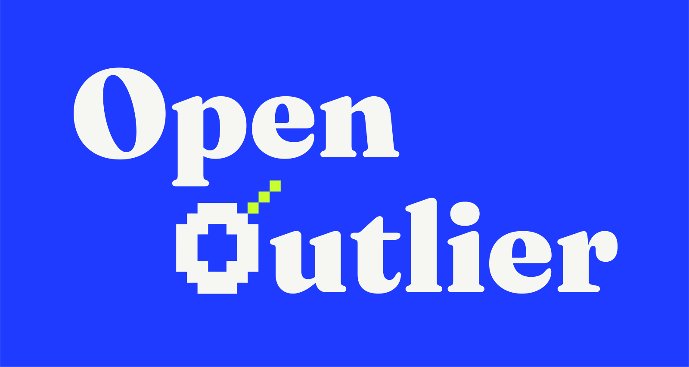
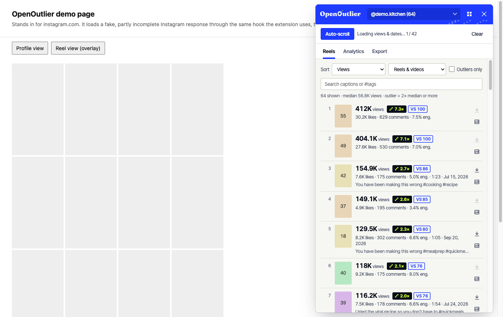
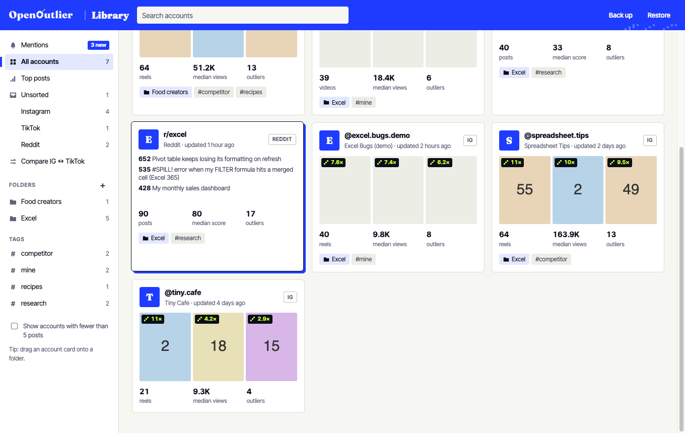
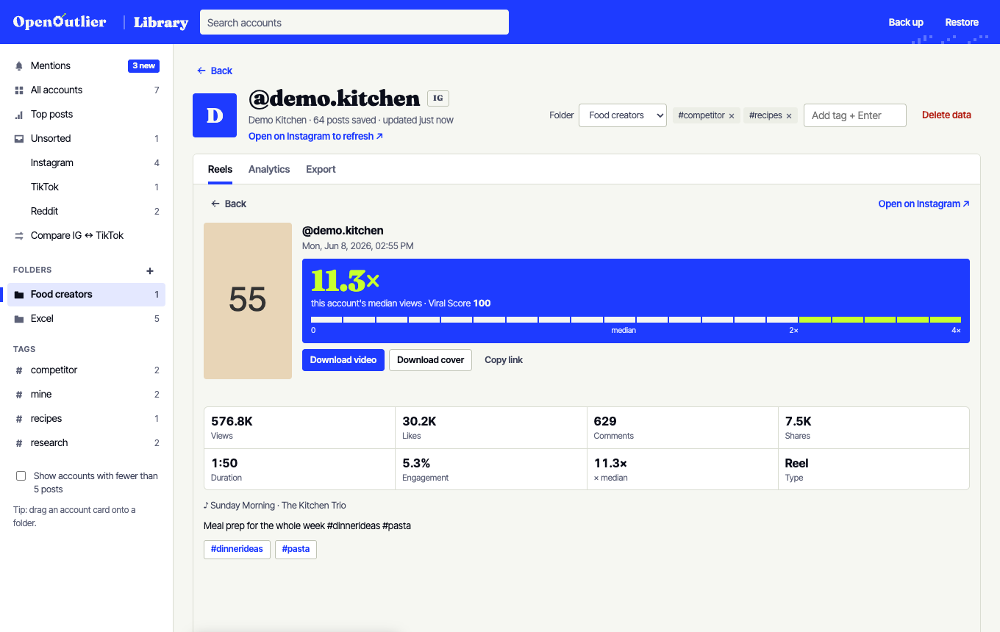
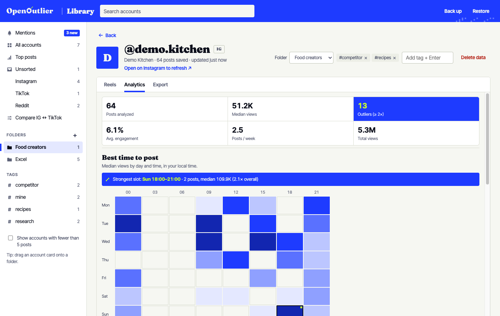
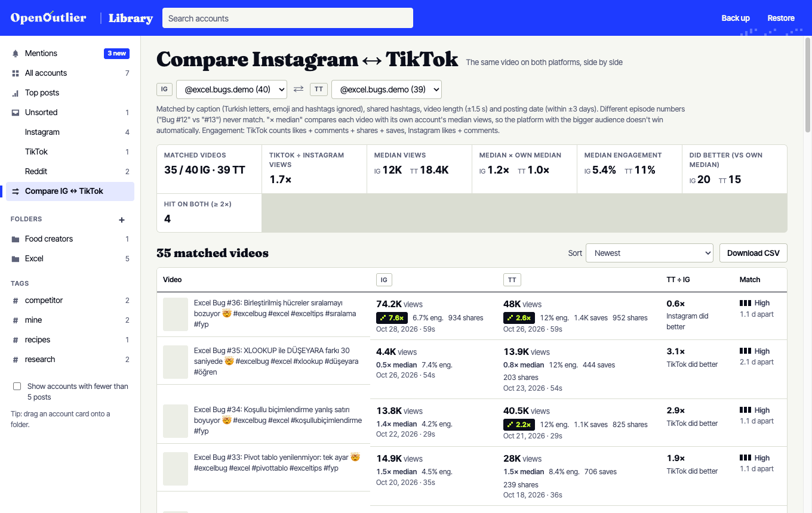
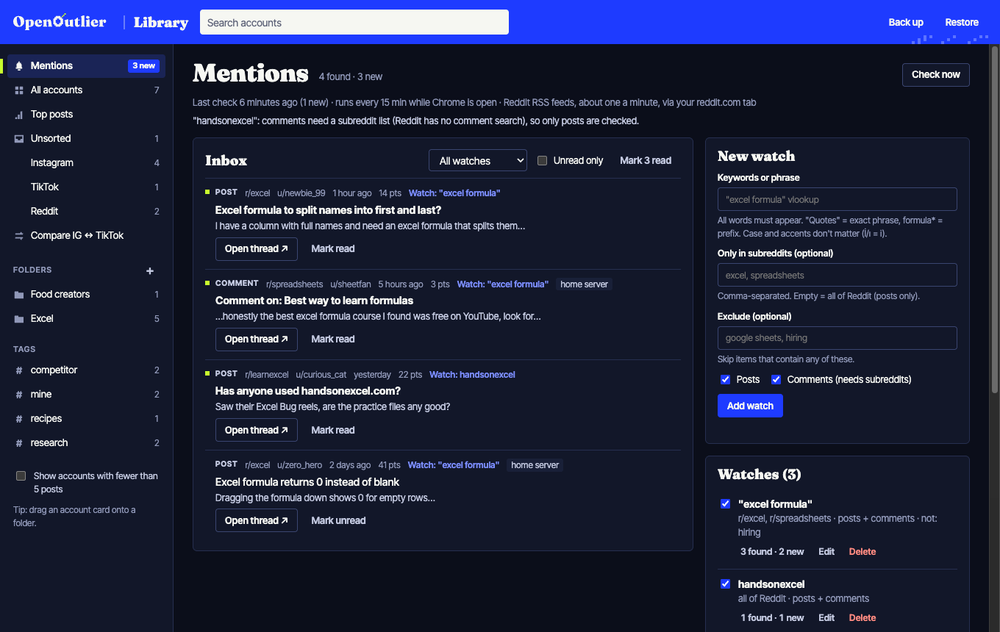
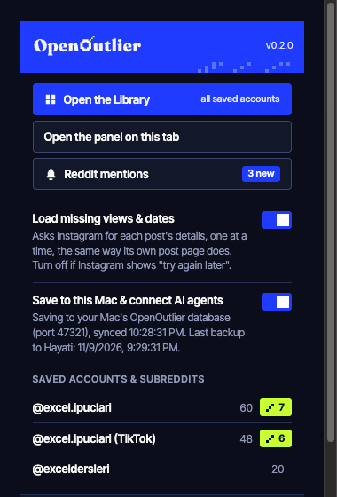

<p align="center">
  
</p>

<p align="center">
  <b>Find the posts that broke away from an account's normal.</b><br>
  Free, open-source analytics for Instagram Reels, TikTok and Reddit, right inside the page you're on.
</p>

<p align="center">
  <a href="LICENSE">MIT license</a> · Chrome &amp; Edge (Manifest V3) · no account, no tracking, no server · <a href="#install">Install</a> · <a href="#connect-ai-agents-mcp">MCP for AI agents</a>
</p>

---

Most posts land near an account's median. A few get **2×, 5×, 10× that**. Those outliers tell you which hooks, topics, lengths and posting times work, for you and for the accounts you learn from. OpenOutlier collects the posts your browser already loads on instagram.com, tiktok.com and reddit.com, scores each one against its own account's median, and shows you the ones that broke away.

<p align="center">
  
</p>

## What it does

- **Outliers, in one number.** Every post gets `views ÷ account median`. At 2× or more it gets a lime outlier badge (`9.0×`), and you can filter to outliers only.
- **Viral Score (0–100).** `50 + 25 × log2(views ÷ median)`: 50 is a typical post, 75 is 2×, 100 is 4× or more.
- **Sort what the apps won't sort.** Reels and TikTok videos by views, Viral Score, likes, comments, shares, saves, engagement, date or length. Reddit posts by score, comments, upvote ratio or comments per point.
- **Best time to post.** A day × time heatmap in your local time. Each post is compared with what the account was getting at the time (so growth doesn't make old slots look bad), slots with few posts are pulled toward 1×, and only slots with 8+ posts are ranked. It also scores days and times separately, shows each slot's share of posts, and warns when an account posts at too few times to compare.
- **What works.** Hashtags, video length and sound (original vs. music) ranked by median views. On Reddit: questions vs. statements, title length, words and phrases, flair and post type.
- **Compare Instagram ↔ TikTok.** Post the same videos on both? OpenOutlier pairs them and shows which platform did better relative to each account's own median.
- **Library.** Every account you collect, in folders and tags, with a cross-account *Top posts* ranking, account pages and a Reddit *Mentions* inbox for keyword alerts.
- **Export & download.** CSV, copy-for-Sheets/Excel or JSON. Videos, photos and covers saved with their stats in the file name.
- **AI agents.** A local MCP server lets Claude, Cursor or any MCP client query your library, rank posts, pull mp4s and turn Reddit questions into content ideas.

Everything runs and stays in your browser (plus an optional SQLite copy on your own Mac). OpenOutlier only reads; it never posts, likes, follows, votes, comments or sends messages.

> OpenOutlier is an independent project. It is not affiliated with Instagram, Meta, TikTok, ByteDance, Reddit, or any commercial analytics tool.

## A look around

| | |
|---|---|
|  |  |
| **Library.** All accounts with median, outliers and their best posts; folders, tags, platform filters. | **Post detail.** The verdict (× median and Viral Score), every stat, caption, hashtags, downloads. |
|  |  |
| **Analytics.** Outliers, engagement, posts per week and the best-time heatmap. | **Compare IG ↔ TikTok.** The same video on both platforms, each against its own median. |
|  |  |
| **Mentions.** Keyword watches on Reddit with an inbox, in light or dark. | **Toolbar popup.** Library, panel, settings and your saved accounts with their outlier counts. |

## Install

OpenOutlier isn't in the Chrome Web Store yet. Load it in developer mode:

1. Download this repository (`git clone`, or **Code → Download ZIP** and unzip).
2. Open `chrome://extensions` (Edge: `edge://extensions`) and turn on **Developer mode**.
3. Click **Load unpacked** and pick the folder that contains `manifest.json`.
4. Reload any open Instagram, TikTok and Reddit tabs.

## Use

**Instagram.** Open a profile's Reels tab (`instagram.com/<name>/reels/`), then scroll or press **Auto-scroll** in the OpenOutlier panel (the blue button at the bottom right). Use the **Reels**, **Analytics** and **Export** tabs. On a reel page (`/reel/…`, `/p/…`) a small toolbar sits on the video: download, cover, and a stats card with the post's × median.

**TikTok.** Open a profile (`tiktok.com/@name`), scroll or press **Auto-scroll** until the panel says it has all videos, then use **Videos**, **Analytics** and **Export**. TikTok shows shares and saves publicly, so engagement counts likes + comments + shares + saves, and Analytics adds shares and saves per 100 views. Saved as `tt/name` in the Library.

**Reddit.** Open a subreddit or a user while logged in (`reddit.com/r/excel/`), press **Collect top posts** (it opens the top posts of the year and scrolls them) or scroll yourself, then use **Posts**, **Analytics** and **Export**. Saved as `r/excel` / `u/name`.

**Library.** Toolbar popup → **Open the Library**, or the grid button in the panel. Drag account cards onto folders, add tags on an account page, rank **Top posts** across a folder, and open **Compare IG ↔ TikTok** when you have both.

Data is saved per account in `chrome.storage.local`. Delete it with **Clear** in the panel or **Delete all data** in the popup.

## Features in detail

<details>
<summary><b>Instagram</b></summary>

| | |
|---|---|
| **Sort reels** | by views, Viral Score, likes, comments, shares, engagement rate, date or length. Instagram itself can't sort a profile by views. |
| **Outliers** | posts with ≥ 2× the profile's median views get a `2.4×` badge; filter to outliers only. |
| **Best time to post** | day × time heatmap of era-adjusted lift (views ÷ the account's median at the time), in your local time; thin slots are faded and pulled toward 1×, best day and best time are scored separately, and a note says when there isn't enough variety to compare. |
| **Hashtags** | ranked by the median views of the posts that use them. |
| **Video length & audio** | median views by duration bucket; original audio vs. licensed music; top tracks. |
| **Export** | CSV download, copy as a table for Google Sheets / Excel, or JSON. |
| **Reel overlay** | on any reel or post page: download, cover download and a stats card (views, likes, comments, shares, duration, engagement, × the creator's median). |
| **Download** | videos, photos, carousel slides or covers, one at a time or the whole list, to `Downloads/OpenOutlier/<username>/` with the stats in the name: `1.2Mviews_11.1Klikes_13Kcomments_2.0pct_post_CODE.mp4`. |
| **Post detail** | click any post for the detail card; ⌘/Ctrl-click opens it on Instagram. |
| **Dark mode** | follows the site's theme. |

Instagram's profile grids send slim records (the Reels tab often leaves out the date, caption and length). To fill the gaps OpenOutlier asks Instagram for one post's details at a time (`/api/v1/media/{id}/info/`, the same request Instagram's own post page makes), about 2 seconds apart, backing off for 30, 60, then 120 s if Instagram says to slow down. Turn it off in the popup (**Load missing views & dates**) to only read what Instagram loads while you scroll.

Instagram has renamed its view counter several times. `src/extract.js` checks `play_count`, `ig_play_count`, `view_count`, `video_view_count`, `video_play_count` and `fb_play_count`, in that order; if counts stop showing up after an Instagram update, start there.
</details>

<details>
<summary><b>TikTok</b></summary>

| | |
|---|---|
| **Sort videos** | by views, Viral Score, likes, comments, **shares**, **saves**, engagement rate, date or length; no 20–25 video limit. |
| **Analytics** | outliers and Viral Score against the account's median, best-time heatmap, hashtags (TikTok's own hashtag list), video length, original sound vs. music, top music, shares and saves per 100 views. |
| **Export** | CSV / Sheets / JSON with TikTok columns (`platform, …, shares, saves, …, sound, hashtags, caption`). |
| **Video overlay** | on `/@name/video/<id>`: views, likes, comments, shares, saves, length, engagement, × the creator's median, sound; download video and cover. |
| **Downloads** | `Downloads/OpenOutlier/tt_<name>/250Kviews_12Klikes_300comments_1.1Kshares_2.4Ksaves_6.3pct_tiktok_<id>.mp4`. |

**Where the data comes from: only what tiktok.com already loads in your tab.** TikTok signs its API requests (X-Bogus, X-Gnarly, msToken), so OpenOutlier makes none of its own:

1. `src/hook.js` reads the responses of TikTok's own `/api/post/item_list/`, `/api/item/detail/`, `/api/repost/item_list/`, `/api/recommend/item_list/` and `/api/search/…` calls as they arrive.
2. It reads the JSON TikTok embeds in the page (`__UNIVERSAL_DATA_FOR_REHYDRATION__`, older `SIGI_STATE`) for the video page and the profile's follower and video counts.
3. **Auto-scroll** scrolls the profile so TikTok loads the next page by itself. If TikTok shows a puzzle, OpenOutlier stops and asks you to solve it.

**Video downloads.** TikTok's video links only work with the site's session and referer. OpenOutlier first tries a normal download; if TikTok refuses, it fetches the file inside an open tiktok.com tab and saves those bytes. From the Library, keep a tiktok.com tab open for video downloads. Links expire after hours to days; open the profile again to refresh them.

**Compare Instagram ↔ TikTok.** A pair needs a similar caption (Turkish letters, emoji and hashtags ignored), shared hashtags, the same length (±1.5 s) and dates within ±3 days; different episode numbers ("Bug #12" vs "#13") never match. You see views, engagement and × each account's own median, which side did better, the typical TikTok ÷ Instagram ratio, hits on both, and videos posted on only one side. Download the pairs as CSV.
</details>

<details>
<summary><b>Reddit</b></summary>

| Instagram | Reddit |
|---|---|
| Sort reels by views | Sort a subreddit's or user's posts by **score**, comments, upvote ratio, comments per score or date; filter by post type and flair. |
| Outliers (× median) | How many times the subreddit's (or user's) **median score** a post got; same Viral Score formula. |
| Best time to post | Day × time heatmap of era-adjusted score lift (same method as Instagram). |
| Hashtags | **Title analysis**: question vs. statement, title length, words and two-word phrases that perform; **flair** and **post type** performance. |
| Library | Subreddits and Reddit users sit in the same folders as Instagram and TikTok accounts. |

Read-only, from your own logged-in tab, never the official API:

1. Every `<shreddit-post>` on the page (and the ones that load as you scroll) is read from its attributes.
2. **Collect top posts** opens the top posts of the year (or the user's posts) and scrolls until no more load (up to 1,000). Reddit answers its listing `.json` with HTTP 403 even for logged-in tabs, so the page is the source; page data has no upvote ratio.
3. Agents (`collect_subreddit`) try the listing JSON once; after a 403 OpenOutlier remembers that for a day and reads the page in a small unfocused window.
</details>

<details>
<summary><b>Reddit Mentions (keyword alerts)</b></summary>

Watch Reddit for keywords without a server: **Library → Mentions** (or the popup).

- **Watches**: a query plus optional subreddits, exclude words and kinds (posts / comments). Every word must appear, `"quotes"` = exact phrase, `formula*` = prefix; case, accents and Turkish İ/ı don't matter.
- **Checks** run every 15 minutes while Chrome is open, using Reddit's RSS/Atom feeds (`/search.rss` for posts, `/r/<sub>/comments/.rss` for comments, so comment watches need a subreddit list). Feeds allow about one request a minute; OpenOutlier queues them ≥ 61 s apart and backs off on 429s.
- **New matches** show a Chrome notification and a toolbar badge, and land in the **inbox**: filter by watch, unread only, mark read, open the thread. The newest 3,000 are kept.
- **Home server (optional, off by default)**: link the companion reddit-watch service (a separate project) for 24/7 watching while Chrome is closed. OpenOutlier pushes its watch list (`PUT /watches`) and pulls `GET /mentions?since=…` into the same inbox. The token is never written to backup files.
</details>

## Connect AI agents (MCP)

OpenOutlier ships a local [MCP](https://modelcontextprotocol.io) server, so Claude (Desktop or Code), Cursor or any MCP client can use your library. Everything stays on your computer.

**1. Install the server's dependencies (once)**

```bash
cd mcp && npm install
```

**2. Add it to your agent.** The server id is `openoutlier`, so its tools show up as `mcp__openoutlier__…`. If you added it as `reelscope` (the former name), remove that entry and add it again under the new id (see *Moving from ReelScope* below).

Claude Code:

```bash
claude mcp add -s user openoutlier -- node /absolute/path/to/this/repo/mcp/server.mjs
```

Claude Desktop (*Settings → Developer → Edit Config*), then restart Claude. Use the full path to `node` (`which node`); desktop apps don't see your shell's PATH.

```json
{
  "mcpServers": {
    "openoutlier": {
      "command": "/full/path/to/node",
      "args": ["/absolute/path/to/this/repo/mcp/server.mjs"]
    }
  }
}
```

**3. Keep "Save to this Mac & connect AI agents" on** in the toolbar popup. Its status line shows when the extension is connected.

<details>
<summary><b>Tools agents get</b></summary>

| Tool | What it does |
|---|---|
| `list_accounts` | saved accounts with platform, folder, tags, post counts, median views, outliers |
| `list_folders_and_tags` | your folders and tags |
| `account_summary` | one Instagram or TikTok account's analytics: best slots, hashtags, length, sounds, top videos |
| `top_reels` | rank reels and TikTok videos across a folder / tag / accounts by Viral Score, views, saves, engagement… |
| `compare_platforms` | match the same videos on an Instagram and a TikTok account and compare them |
| `search_reels` | find posts by caption, hashtags or audio |
| `get_reel` | everything about one post, incl. the mp4 `video_url`, `cover_url` and link expiry |
| `download_reel` | save the mp4 and/or cover to `~/Downloads/OpenOutlier/<account>/` and return the path |
| `refresh_reel` | fresh stats and links for one post |
| `reel_history` | how a post's views, likes, comments, shares and saves changed over time |
| `collect_profile` | the extension collects an Instagram or TikTok profile (or a subreddit) in your browser |
| `subreddit_summary` | one subreddit or user: best slots, title analysis, flairs, post types, top posts |
| `top_posts` | rank Reddit posts across subreddits by Viral Score, score, comments… |
| `content_ideas` | the most-upvoted questions and pain points in a set of subreddits, and how many reels your folder already made about each |
| `collect_subreddit` | the extension collects a subreddit / user with your logged-in Chrome |
| `mentions` | the Mentions inbox and watch list |
| `command_status`, `bridge_status` | check a running command / the connection and backups |

Example prompts: *"Use compare_platforms for my account: which episodes did better on TikTok, and what do they have in common?"* · *"Compare the 10 most viral reels in my Excel folder from the last 90 days and summarize their hooks."* · *"Collect r/excel and r/spreadsheets, then use content_ideas on my Excel folder and give me 10 reel ideas my competitors haven't covered."*
</details>

<details>
<summary><b>How the connection works</b></summary>

The MCP server keeps your library in `~/.openoutlier/openoutlier.db` and opens a small bridge on `127.0.0.1`, on the first free port in 47811–47820. The extension scans the same ports and only talks to a server that identifies itself as OpenOutlier. The bridge accepts requests only from the browser extension, never from websites (it checks the `Origin` and `Host` headers), and pairs with the first extension that connects; to re-pair, delete `~/.openoutlier/config.json`. Agent commands for Instagram run in a tab you already have open (or a background tab); Reddit and TikTok commands use a small unfocused window with your logged-in session and close it when done.
</details>

## Your data: SQLite on your Mac, backed up daily

The extension's storage disappears if you remove the extension, so OpenOutlier can keep a durable copy on your computer.

- **`~/.openoutlier/openoutlier.db` (SQLite)**, written by the bridge whenever the extension's data changes: every account, post, folder, tag, watch and mention, plus a **history table** with a dated row each time a post's numbers change (the `reel_history` tool).
- **Safe by design.** A full sync only adds and updates, so a reinstalled extension with empty storage can't wipe the database. An account is removed only when you delete it in the extension.
- **Daily backup** (`mcp/backup.mjs`): a consistent copy (`VACUUM INTO`) with an integrity check, gzipped, the last 7 kept in `~/.openoutlier/backups/`, then uploaded over SSH to `OPENOUTLIER_BACKUP_REMOTE` (`host:/path`), checksum-verified there, the last 30 kept. Runs at 03:30, or at login/wake if missed.
- **Always on (macOS)**: `sh mcp/launchd/install.sh` installs `dev.openoutlier.bridge` (keeps the bridge running) and `dev.openoutlier.backup` (the daily backup). Logs: `~/.openoutlier/logs/`. Remove with `sh mcp/launchd/uninstall.sh`; your data stays.
- **Status**: the popup shows the last backup (or a warning); `bridge_status` reports database counts.

<details>
<summary><b>Restore a backup</b></summary>

```bash
launchctl bootout gui/$(id -u)/dev.openoutlier.bridge
scp <host>:<path>/openoutlier-YYYY-MM-DD.db.gz ~/.openoutlier/
gunzip -f ~/.openoutlier/openoutlier-YYYY-MM-DD.db.gz && mv ~/.openoutlier/openoutlier-YYYY-MM-DD.db ~/.openoutlier/openoutlier.db
rm -f ~/.openoutlier/openoutlier.db-wal ~/.openoutlier/openoutlier.db-shm
launchctl bootstrap gui/$(id -u) ~/Library/LaunchAgents/dev.openoutlier.bridge.plist
```

Backups from before the rename are named `reelscope-YYYY-MM-DD.db.gz`; restore them the same way.
</details>

<details>
<summary><b>Moving from ReelScope</b></summary>

OpenOutlier was called ReelScope. An install that still has `~/.reelscope/reelscope.db`, the `REELSCOPE_*` variables or the `dev.reelscope.*` agents keeps working as is: the server uses `~/.reelscope` while `~/.openoutlier` doesn't exist, and every `OPENOUTLIER_*` variable falls back to its `REELSCOPE_*` name. To move over:

```bash
claude mcp remove reelscope -s user
claude mcp add -s user openoutlier -- "$(which node)" /absolute/path/to/this/repo/mcp/server.mjs
launchctl bootout gui/$(id -u)/dev.reelscope.bridge
pkill -f mcp/server.mjs   # every running MCP server still has the old path; their agents restart them
mv ~/.reelscope ~/.openoutlier && mv ~/.openoutlier/reelscope.db ~/.openoutlier/openoutlier.db
sh mcp/launchd/install.sh  # replaces dev.reelscope.* and keeps your backup target
```

Then start a new agent session so it picks up the `openoutlier` tools.
</details>

> **Why `reelscope` inside the extension?** The extension's own storage (`rs:*` keys, the `reelscope` IndexedDB), its message names and the bridge handshake (`{"app":"reelscope"}`) keep the former name: renaming them would empty the library stored in the extension and break an older extension talking to a newer server.

## Privacy

- No analytics, no tracking, no remote servers. The only requests OpenOutlier makes are to instagram.com and reddit.com themselves (post details, listing pages), to TikTok's and Instagram's file hosts when you download, all from your own session, and, if you use agents, to the MCP server on `127.0.0.1`.
- Fonts (Fraunces, Inter Tight; SIL OFL) are bundled in `fonts/`; nothing is loaded from Google or any CDN.
- Permissions: `storage` + `unlimitedStorage` (collected posts), `downloads` (media files), `alarms` (MCP connection check, Mentions), `notifications` (new Mentions), `scripting` (the read-only Mentions request inside your reddit.com tab), host access to instagram.com, tiktok.com, reddit.com and their file hosts, and optional access to your reddit-watch server (asked only when you connect one).
- The Library caches cover images in the extension's own IndexedDB, so covers keep showing after the platforms' links expire.
- It never asks for your Instagram, TikTok or Reddit password.

## How it works

```
instagram.com page
 ├─ src/hook.js      (page world) reads Instagram's own /graphql and /api/v1/ responses; makes no requests
 ├─ src/extract.js   Instagram JSON → normalized post records
 ├─ src/metrics.js   Viral Score, outliers, analytics, CSV/TSV (pure, Node-tested)
 ├─ src/brand.js     bundled fonts (FontFace) + logo SVGs for the panel
 ├─ src/panel.js     the in-page panel (Shadow DOM, textContent only)
 ├─ src/overlay.js   toolbar + stats card over the post being viewed
 └─ src/content.js   storage, missing-details loader, profile detection, auto-scroll
tiktok.com page      src/tiktok.js (JSON → posts) + src/tiktok-content.js (storage, SSR scan, auto-scroll, download fallback)
reddit.com page      src/reddit.js (listing JSON / <shreddit-post> → posts) + src/reddit-content.js (Collect top posts)
src/background.js    downloads, opens the Library
src/compare.js       matches the same video across Instagram and TikTok
src/agent-bridge.js  syncs the library to the local MCP server and runs agent commands
src/mentions*.js     Reddit keyword matching and the 15-minute checker
mcp/                 MCP server, 127.0.0.1 bridge, SQLite store, backup, launchd install
dashboard/           the Library page
popup/               the toolbar popup
brand/               the OpenOutlier identity (see brand/README.md)
```

## Develop

No build step: edit the files and press reload on `chrome://extensions`.

```bash
npm test                          # unit + MCP end-to-end tests (Node 20+; run `npm install` in mcp/ first)
python3 -m http.server 8791       # then open http://127.0.0.1:8791/dev/demo.html
```

The `dev/` pages run the real scripts with a stubbed `chrome` API and fake data, so you can work on the UI without opening the real sites: `demo.html` (Instagram profile + reel overlay), `tiktok-demo.html`, `reddit-demo.html`, `dashboard-demo.html` (Library, incl. `#/compare` and `#/mentions`), `popup-demo.html` (add `?empty` for the first-run state) and `design-mock.html` (the clickable design reference). Fixtures: `node dev/make-fixture.mjs`, `make-reddit-fixture.mjs`, `make-tiktok-fixture.mjs`.

**Design.** The identity ("Signal Field": Signal Blue `#1E3BFF`, Outlier Lime `#C8FF2E`, Fraunces Black + Inter Tight, the Pixel O) and its rules live in [`brand/README.md`](brand/README.md). In short: the colour logo sits only on blue or ink, and lime is reserved for outliers and never sits on light paper.

## Roadmap

- [x] Instagram, TikTok and Reddit; Library; Instagram ↔ TikTok comparison; MCP; SQLite + backups
- [ ] TikTok comments and transcripts (subtitles TikTok already loads)
- [ ] Reddit thread comments for deeper pain-point mining
- [ ] Transcripts with your own API key
- [ ] Firefox support
- [ ] Chrome Web Store / Edge Add-ons listing

Contributions are welcome: open an issue or a pull request.

## Responsible use

Use OpenOutlier for research on public content. Download only content you own or have permission to use. Respect creators' copyright and Instagram's, TikTok's and Reddit's terms. OpenOutlier paces its requests; don't run it in loops.

## Credits

The idea of reading Instagram's own network responses (instead of the page markup) was inspired by [leoplanello/instagram-reels-sorter](https://github.com/leoplanello/instagram-reels-sorter). OpenOutlier's code is written from scratch. Fonts: [Fraunces](https://github.com/undercasetype/Fraunces) and [Inter Tight](https://github.com/rsms/inter), SIL Open Font License 1.1.

## License

[MIT](LICENSE)
